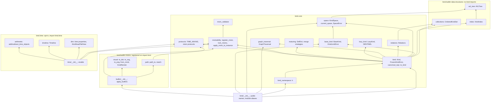

# Architecture

`kind` is 23 modules in four groups. Each group imports only from the groups below it at import time.
The only exceptions are a few deferred imports inside function bodies, named below. The data lives in a
space (`KindSpace`): one pool, one creation order and one lock per space. A Kind is a slotted object
whose edges are guarded sets. The [API reference](reference/api.md) lists every name; this page shows
how the names fit together.

## Modules and dependency direction

The diagram shows runtime imports. An arrow points from the importer to the module it imports.
Imports used only for type checking (`if TYPE_CHECKING:`) are left out.



- **`kind.builtin` sits on both sides of the core.** `avl_tree`, `collections` and `index` are plain data
  structures that the core is built from. `path` and `visual` are mixins that `import kind` registers on
  every Kind through `apply_builtins()`.
- **Four deferred imports** go back to `kind.core.kind`, each from inside a function body:
  `visual.from_mmd`, `LazyKind.evaluate`, the `patch` merge strategy in `maturing`, and
  `register_mixin`'s default target (`base_kind`).
- **The core never imports `kind.time`.** It only reserves the time attribute names
  (`protocols.TIME_MIXINS`). Without `import kind.time`, `kind.as_date` raises an `AttributeError` that
  says time is opt-in, instead of turning into a relation verb.
- **`kind/__init__.py` loads everything else eagerly.** The module aliases (`kind.td`, `kind.vis`,
  `kind.idx`, ...) resolve on first access. An alias into `kind.time` opts in to time, as
  `import kind.time` does.

The modules, as `git ls-files kind` lists them:

| Group | Modules |
|---|---|
| package | `kind/__init__.py`, `kind/py.typed` |
| `kind.core` | `__init__`, `base_kind`, `graph_traversal`, `kind`, `kind_namespace`, `lazy_kind`, `maturing`, `mixin_validator`, `mixinability`, `protocols`, `relations`, `space` |
| `kind.builtin` | `__init__`, `avl_tree`, `collections`, `index`, `path`, `visual` |
| `kind.time` | `__init__`, `arithmetic`, `dim`, `timeline` |

Runtime dependencies are `orjson`, `PyYAML`, `tomli-w` (plus `tomli` on Python 3.10) and `anyio`, which
runs the `a_to_svg`/`a_to_png` renderers in a worker thread. The `visual` extra adds `graphviz`; the
`dot` executable must be installed separately. Python 3.10 or newer is required.

## Data model

### Space

A `KindSpace` holds:

| Attribute | Contents |
|---|---|
| `pool` | `dict` from name to Kind. |
| `order` | `AVLTree` of the same Kinds, keyed by creation position. |
| `lock` | `threading.RLock`. |
| `max_kinds` | The cap; `None` means unbounded. |
| `closed` | Set by `close()`. |
| private counters | The next creation position, and the next `Kind.next()` number. |

How the spaces behave:

- **Current space.** It is a context variable (`current_space()`). A process starts in a default space,
  which cannot be closed.
- **Lookup.** `Kind(name)` takes the current space's lock, returns the pooled Kind if the name exists,
  and otherwise creates one. A new Kind is refused with
  [`KindLimitError`](reference/errors.md#kindlimiterror) when the space is at `max_kinds`, and with
  [`SpaceError`](reference/errors.md#spaceerror) when the space is closed.
- **Identity.** Equality is name and space. The hash is the name alone.
- **Closing.** `with KindSpace() as space:` makes the space current inside the block and closes it on
  exit. A closed space drops its pool. Kinds still referenced elsewhere stay readable, but every change
  to them raises `SpaceError`, and so does an edge between two spaces.

### Kind

A Kind is a slotted object; it has no `__dict__`.

| Slot | Contents |
|---|---|
| `name`, `origin`, `node_shape` | Identity, the source value (the first non-`None` origin given wins), and the Mermaid shape. |
| `parents`, `children` | `OrderedKindSet`: an insertion-ordered list plus a set for O(1) membership, so an edge is never stored twice. |
| `_position`, `_prev`, `_next` | Creation position in `space.order`, and the `Kind.next()` chain. |
| `_space` | The owning space, read through `kind.space`. |
| `_metadata`, `_context`, `_index`, `_relations` | Created on first access. Until then they hold the `SENTINEL` marker. |
| `_elevated_attributes` | Attributes set at runtime: assignments, `elevate()`, `apply_mixin_to_instance`. |
| `_frozen` | Set by `freeze()` and `immute()`. |

`name`, `parents`, `children`, `_position`, `_prev`, `_next` and `_space` are structural: assigning or
deleting them raises `AttributeError`. Edges change only through `append`, `insert`, `relate`, `delete`
and the other graph methods.

### Edge sets

Every `OrderedKindSet` that belongs to a Kind (`children`, `parents`, each relation's targets)
carries a **guard**, run before every `add`, `insert`, `remove`, `discard`, `pop` and `clear`. It
lets a change through only inside a Kind edge method (`append`, `insert`, `relate`, `unrelate`,
`reparent`, `delete`), which keeps both ends of every edge in step; it then applies the owner's
mutability check. So the sets are readable, and a direct mutation raises:

- [`AttributeError`](reference/errors.md#attributeerror) for any direct change, frozen or not;
- [`FrozenKindError`](reference/errors.md#frozenkinderror) when an edge method meets a frozen Kind;
- [`SpaceError`](reference/errors.md#spaceerror) when the owner's space is closed.

Operations that change several Kinds (`delete`, `reparent`, `patch`, `unrelate`) check all of them
before changing any. A refusal therefore leaves no half-applied edit.

```python
from kind import Kind, KindSpace, SpaceError, FrozenKindError

catalog = Kind('Catalog')
try:
    catalog.children.add(Kind('Book'))       # only Kind edge methods change edge sets
except AttributeError as error:
    print(error)
catalog.freeze()
try:
    catalog.append(Kind('Book'))
except FrozenKindError as error:
    print(error)

with KindSpace(name="scratch"):
    draft = Kind('Draft')
    try:
        draft.relate(catalog)                # catalog lives in the default space
    except SpaceError as error:
        print(error)
```
<details>
<summary>Outcome</summary>

```text
The edge sets of Kind 'Catalog' change only through append, insert, relate, unrelate, reparent and delete, which keep both ends of every edge. Hint: call one of those instead of changing children/parents/relations directly.
Kind 'Catalog' is frozen (immute()/freeze()); it cannot change. Hint: change it before maturing, or build a new Kind.
Cannot link 'Draft' in KindSpace('scratch', 1 kinds) to 'Catalog' in KindSpace('default', 2 kinds): an edge across spaces would make their lifetimes undefined. Hint: create both inside the same `with KindSpace():` block.
```
</details>

### Relations

`kind.relations` is a `Relations` object: a `dict` from `how` to a guarded `OrderedKindSet`.
`a.relate(b, how)` adds `b` under `how` on `a` and records the inverse on `b` under `_inverse_<how>`.
`unrelate` removes both ends.

`Kind.__getattr__` resolves an unknown public name in this order:

1. the Kind's elevated attributes;
2. a reserved time name, which raises `AttributeError` with a hint to `import kind.time`;
3. otherwise a relation verb: `a.has_kind(b)` is `a.relate(b, how='has_kind')`.

Names starting with `_` and names the class defines never become verbs.

Relations hold strong references, like children do. Serialization and rendering write forward relations
only; the `_inverse_` entries are rebuilt when a graph is read back.

### Concurrency

How the space lock applies to the operations:

- **Mutations.** Mutations of one space are serialized by its `RLock`.
- **Reads.** Traversal, rendering and serialization iterate snapshots of each Kind's edges, copied
  under that lock.
- **Composite operations** made of several calls are not atomic as a whole.

The current space follows the context:

- asyncio and trio tasks inherit it, and so do anyio worker threads;
- a plain `threading.Thread` sees the default space unless it runs inside
  `contextvars.copy_context().run(...)`.

## Extension points

| Mechanism | Scope | Notes |
|---|---|---|
| `register_mixin(value, name=None, target_class=None, safe=True, expand=True)` | Every Kind (default target `BaseKind`) | Classes and modules are expanded into their public members. Strings are refused, and so are private and dunder names; core names are refused unless `safe=False`. The validator checks only that the first parameter is `self`: a mixin is trusted code. |
| `lock_mixins()` / `mixins_locked()` | Process | After locking, every registration is refused. |
| `apply_mixin_to_instance(kind, mixin)` | One Kind | Stores the members as that Kind's elevated attributes, bound to the Kind (properties evaluated once). |
| Builtin mixins | Every Kind, on `import kind` | `path_to` and `match` (`kind.builtin.path`); `to_dot`, `to_svg`, `to_png`, `a_to_svg`, `a_to_png` and `from_mmd` (`kind.builtin.visual`). `KindRender(kind)` wraps the Graphviz renderers. Mermaid (`to_mmd`) and ASCII (`to_ascii`) belong to `Kind` itself. |
| `kind.time` | Every Kind, after `import kind.time` | `enable()` registers the time properties (`as_date`, `hour`, `period`, ...) and the views `time_head` / `time_tail`. They apply to names that are ISO 8601 dates or datetimes. |

## What lives elsewhere

Scheduling and batch processing are the separate distribution `kind-scheduler`, in
[`scheduler/`](../scheduler/README.md) (package `kind_scheduler`). It depends on `kind` and adds
`croniter` and `typer`; `kind` does not depend on it.

Publishing is deferred: both distributions are private, with the classifier `Private :: Do Not Upload`,
and are installed from the checkout (`make install`).
