# Kind Architecture

## Introduction

The `kind` library is a Python framework for creating, manipulating, and reasoning about symbolic data structures. It is designed to be lightweight, extensible, and memory-aware, providing a powerful foundation for a wide range of applications, from data modeling and graph analysis to metaprogramming. (Scheduling lives in the separate `kind-scheduler` distribution in `scheduler/`, package `kind_scheduler`.)

At its core, the `kind` library is built upon a layered architecture that separates the fundamental `Kind` class from its extended functionalities. This design promotes modularity, reduces complexity, and allows for a high degree of customization through mixins and builtin extensions.

This document provides a detailed overview of the `kind` library's architecture, including its core components, builtin extensions, and the principles that guide its design.

## Core Architecture

The core architecture of the `kind` library is divided into two main layers, the **Core Layer** and the **Builtin Extensions Layer**, plus the opt-in **Time Layer** (`kind.time`).

```mermaid
graph TD
    subgraph "Kind Package"
        A[kind] --> B(kind.core)
        A --> C(kind.builtin)
        A --> T(kind.time, opt-in)
    end

    subgraph "Core Layer (kind.core)"
        B --> B1[kind.core.base_kind]
        B --> B2[kind.core.kind]
        B --> B3[kind.core.graph_traversal]
        B --> B4[kind.core.maturing]
        B --> B5[kind.core.mixinability]
        B --> B6[kind.core.mixin_validator]
        B --> B7[kind.core.protocols]
        B --> B8[kind.core.relations]
        B --> B9[kind.core.space]
        B --> B10[kind.core.lazy_kind]
        B --> B11[kind.core.kind_namespace]
    end

    subgraph "Builtin Extensions Layer (kind.builtin)"
        C --> C1[kind.builtin.collections]
        C --> C2[kind.builtin.index]
        C --> C3[kind.builtin.path]
        C --> C4[kind.builtin.visual]
        C --> C5[kind.builtin.avl_tree]
    end

    subgraph "Time Layer (kind.time, import kind.time to enable)"
        T --> T1[kind.time.dim]
        T --> T2[kind.time.timeline]
        T --> T3[kind.time.arithmetic]
    end

    B9 -- uses --> C5
    B1 -- uses --> B9
    B2 -- uses --> B1
    B2 -- uses --> B3
    B2 -- uses --> B4
    B2 -- uses --> B5
    B2 -- uses --> B8
    B2 -- uses --> B9
    B2 -- uses --> B10
    B2 -- uses --> C1
    B2 -- uses --> C2

    B5 -- uses --> B6
    B8 -- uses --> C1
    B11 -- uses --> B2

    C2 -- uses --> B2
    C2 -- uses --> C5
    C3 -- uses --> B2
    C3 -- uses --> B7
    C4 -- uses --> B2

    T -- registers mixins via --> B5
    T1 -- uses --> B2

    style A fill:#FFD700,stroke:#333,stroke-width:2px,color:#000000;
    style B fill:#1E90FF,stroke:#333,stroke-width:2px,color:#FFFFFF;
    style C fill:#32CD32,stroke:#333,stroke-width:2px,color:#000000;
    style T fill:#FF8C00,stroke:#333,stroke-width:2px,color:#000000;

    style B1 fill:#ADD8E6,stroke:#333,stroke-width:2px,color:#000000;
    style B2 fill:#ADD8E6,stroke:#333,stroke-width:2px,color:#000000;
    style B3 fill:#ADD8E6,stroke:#333,stroke-width:2px,color:#000000;
    style B4 fill:#ADD8E6,stroke:#333,stroke-width:2px,color:#000000;
    style B5 fill:#ADD8E6,stroke:#333,stroke-width:2px,color:#000000;
    style B6 fill:#ADD8E6,stroke:#333,stroke-width:2px,color:#000000;
    style B7 fill:#ADD8E6,stroke:#333,stroke-width:2px,color:#000000;
    style B8 fill:#ADD8E6,stroke:#333,stroke-width:2px,color:#000000;
    style B9 fill:#ADD8E6,stroke:#333,stroke-width:2px,color:#000000;
    style B10 fill:#ADD8E6,stroke:#333,stroke-width:2px,color:#000000;
    style B11 fill:#ADD8E6,stroke:#333,stroke-width:2px,color:#000000;

    style C1 fill:#90EE90,stroke:#333,stroke-width:2px,color:#000000;
    style C2 fill:#90EE90,stroke:#333,stroke-width:2px,color:#000000;
    style C3 fill:#90EE90,stroke:#333,stroke-width:2px,color:#000000;
    style C4 fill:#90EE90,stroke:#333,stroke-width:2px,color:#000000;
    style C5 fill:#90EE90,stroke:#333,stroke-width:2px,color:#000000;

    style T1 fill:#FFDAB9,stroke:#333,stroke-width:2px,color:#000000;
    style T2 fill:#FFDAB9,stroke:#333,stroke-width:2px,color:#000000;
    style T3 fill:#FFDAB9,stroke:#333,stroke-width:2px,color:#000000;
```

### Legend

*   **Yellow Boxes**: Core architectural components.
*   **Blue Boxes**: Core Layer modules.
*   **Green Boxes**: Builtin extension modules.
*   **Light Blue Boxes**: Modules within the `kind.core` layer.
*   **Light Green Boxes**: Modules within the `kind.builtin` layer.
*   **Orange / Peach Boxes**: The opt-in `kind.time` package and its modules.
*   Not shown: `kind/__init__.py` (exports `Kind`, `k`, `KindSpace`, `SpaceError`, `current_space`, `KindLimitError`, `GraphTraversal`). Scheduling, batch processing and the `kind-scheduler` CLI are the separate `kind-scheduler` distribution (`scheduler/`, package `kind_scheduler`), which depends on `kind`.
*   **Arrows**: Indicate dependencies between modules.

### Core Layer (`kind.core`)

The Core Layer provides the fundamental building blocks of the `kind` library. It includes the `Kind` class itself, along with essential services for graph traversal, mixin-based extensibility, and memory management.

*   **`base_kind`**: Defines `BaseKind`, the interned, name-identified node: `Kind(name)` looks the name up in the current space's pool, shared by all classes (a name keeps its identity and state until `delete()`/`Kind.forget(name)` or until its space is closed). Equality is name and space; `kind.space` gives a Kind's space.
*   **`kind`**: Extends the `base_kind` with advanced features such as graph traversal, indexing, relations, per-instance freezing, maturing, Mermaid/ASCII rendering and serialization.
*   **`graph_traversal`**: Provides `GraphTraversal(root, traverse_mode, family_mode)`, iterative DFS/BFS over a `Kind` graph.
*   **`relations`**: Holds a Kind's named relations (strong references) and the dynamic relation verbs (`a.has_kind(b)`).
*   **`lazy_kind`**: Defines `LazyKind` (deferred conversion to `Kind`) and the `SENTINEL` marker.
*   **`kind_namespace`**: Provides `k`, where `k.Stock is Kind('Stock')`.
*   **`space`**: Defines `KindSpace(max_kinds=None, name=...)`, one universe of names with its own `pool` (strong dict), `order` (an `AVLTree` by creation position), counters, `lock` (an `RLock`) and `max_kinds` cap (`KindLimitError`). The current space is a context variable (`current_space()`); a process starts with a default space, and `with KindSpace() as space:` opens a separate one that is closed (its Kinds dropped) on exit. Edges or relations across spaces, and changes to a Kind of a closed space, raise `SpaceError`.
*   **`maturing`**: Implements the "maturing" process for `Kind` objects, which involves elevating metadata to first-class attributes and methods.
*   **`mixinability`**: Provides the core functionality for mixin-based extensibility of the `Kind` class (`register_mixin`, `apply_mixin_to_instance`, `lock_mixins`).
*   **`mixin_validator`**: Checks a mixin's signature (first parameter `self`); a mixin is trusted code, so it does not judge what the code does.
*   **`protocols`**: Defines the protocols that govern the behavior of `Kind` objects.

### Builtin Extensions Layer (`kind.builtin`)

The Builtin Extensions Layer provides a collection of optional modules that extend the functionality of the `Kind` class. These modules are designed to be self-contained and can be used independently of one another.

*   **`collections`**: Provides custom collection classes for `Kind` objects, such as `OrderedKindSet`.
*   **`index`**: Provides index capabilities for `Kind` objects.
*   **`path`**: Provides pathfinding capabilities for `Kind` objects.
*   **`visual`**: Provides Graphviz rendering (`to_dot`, `to_svg`, `to_png`, `a_to_svg`, `a_to_png`) and `from_mmd`, as mixins on every `Kind`; Mermaid and ASCII output belong to `Kind` itself.
*   **`avl_tree`**: An implementation of an AVL tree.

### Time Layer (`kind.time`, opt-in)

`import kind.time` (or an alias such as `kind.td`) attaches the time mixins to every Kind; without it a Kind has no time properties. The package exports `KindHeadTailView`, `KindTimeDimMixin`, `Timeline`, `add_time_objects`, `subtract_time_objects`, `parse_timestamp`, `when` and `enable`.

*   **`dim`**: Gives a Kind named like an ISO 8601 date or time a time dimension (`as_date`, `hour`, ...; any other name raises `ValueError`, no fallback). `kind.time_head` / `kind.time_tail` are `KindHeadTailView`s over the temporal Kinds only, whose operations are named for what they return: filters `filter_by_*` → view; selectors `first()`, `last()`, `nth(n)`, `closest(x)`, `furthest(x)` → Kind; reshapers `reversed()`, `shuffled()`, `sample(n)`, `unique()` → view; aggregates `map`, `reduce`, `sum`, `min`, `max`, `average`, `median`, `mode`, `std`, `variance`, `percentile`, `quantile` (taking a function), plus `count()`, `is_empty()`, `any(pred)`, `all(pred)`, `none(pred)`, `span()`.
*   **`timeline`**: Provides a `Timeline` class for representing a series of time periods (`overlap(other)` returns their common periods).
*   **`arithmetic`**: `add_time_objects` / `subtract_time_objects` for `datetime` and `timedelta` values.
