# Module Import Paths

This diagram illustrates the most direct import paths to each accessible module in the `kind` library. It provides a clear overview of the library's public API and how its various components can be accessed.

```mermaid
graph TD
    subgraph "Public API"
        A[kind] --> B(kind.k)
        A[kind] --> C(kind.Kind)
        A[kind] --> D(kind.GraphTraversal)
        A[kind] --> E(kind.process_batch / kind.a_process_batch)
        A[kind] --> E2(kind.add_time / kind.subtract_time)
    end

    subgraph "Core Modules"
        C --> F(kind.core.base_kind)
        C --> G(kind.core.kind)
        C --> G2(kind.core.graph_traversal)
        C --> G3(kind.core.relations)
        C --> G4(kind.core.lazy_kind)
        C --> G5(kind.core.kind_namespace)
        C --> I(kind.core.maturing)
        C --> J(kind.core.mixinability)
        C --> K(kind.core.mixin_validator)
        C --> L(kind.core.protocols)
        C --> N(kind.core.time_arithmetics)
        C --> O(kind.core.schedule)
        C --> P(kind.core.batch_processing)
    end

    subgraph "Builtin Extensions"
        C --> Q(kind.builtin.collections)
        C --> R(kind.builtin.time_dim)
        C --> S(kind.builtin.index)
        C --> T(kind.builtin.path)
        C --> U(kind.builtin.visual)
        C --> W(kind.builtin.avl_tree)
        C --> X(kind.builtin.timeline)
    end

    subgraph "Command Line"
        A --> Y(kind.bin.scheduler)
    end

    style A fill:#FFD700,stroke:#333,stroke-width:2px,color:#000000;
    style B fill:#FFD700,stroke:#333,stroke-width:2px,color:#000000;
    style C fill:#FFD700,stroke:#333,stroke-width:2px,color:#000000;
    style D fill:#FFD700,stroke:#333,stroke-width:2px,color:#000000;
    style E fill:#FFD700,stroke:#333,stroke-width:2px,color:#000000;
    style E2 fill:#FFD700,stroke:#333,stroke-width:2px,color:#000000;

    style F fill:#1E90FF,stroke:#333,stroke-width:2px,color:#FFFFFF;
    style G fill:#1E90FF,stroke:#333,stroke-width:2px,color:#FFFFFF;
    style G2 fill:#1E90FF,stroke:#333,stroke-width:2px,color:#FFFFFF;
    style G3 fill:#1E90FF,stroke:#333,stroke-width:2px,color:#FFFFFF;
    style G4 fill:#1E90FF,stroke:#333,stroke-width:2px,color:#FFFFFF;
    style G5 fill:#1E90FF,stroke:#333,stroke-width:2px,color:#FFFFFF;
    style G6 fill:#1E90FF,stroke:#333,stroke-width:2px,color:#FFFFFF;
    style I fill:#1E90FF,stroke:#333,stroke-width:2px,color:#FFFFFF;
    style J fill:#1E90FF,stroke:#333,stroke-width:2px,color:#FFFFFF;
    style K fill:#1E90FF,stroke:#333,stroke-width:2px,color:#FFFFFF;
    style L fill:#1E90FF,stroke:#333,stroke-width:2px,color:#FFFFFF;
    style N fill:#1E90FF,stroke:#333,stroke-width:2px,color:#FFFFFF;
    style O fill:#1E90FF,stroke:#333,stroke-width:2px,color:#FFFFFF;
    style P fill:#1E90FF,stroke:#333,stroke-width:2px,color:#FFFFFF;

    style Q fill:#32CD32,stroke:#333,stroke-width:2px,color:#000000;
    style R fill:#32CD32,stroke:#333,stroke-width:2px,color:#000000;
    style S fill:#32CD32,stroke:#333,stroke-width:2px,color:#000000;
    style T fill:#32CD32,stroke:#333,stroke-width:2px,color:#000000;
    style U fill:#32CD32,stroke:#333,stroke-width:2px,color:#000000;
    style W fill:#32CD32,stroke:#333,stroke-width:2px,color:#000000;
    style X fill:#32CD32,stroke:#333,stroke-width:2px,color:#000000;
    style Y fill:#32CD32,stroke:#333,stroke-width:2px,color:#000000;
```

