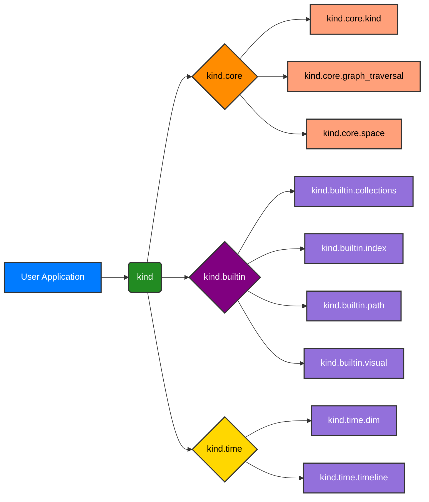
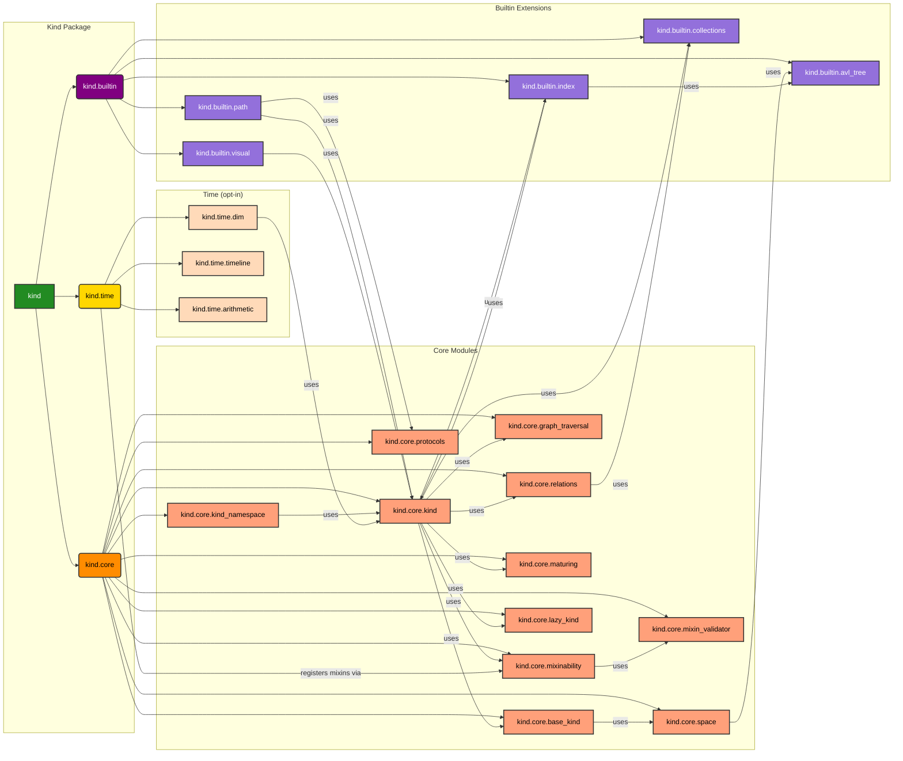

## Project Structure

The project is organized into two main packages and one opt-in package:

-   `kind.core`: Contains the essential `Kind` class, `KindSpace` (the pool, order, lock and cap of one universe of names), graph traversal, relations, mixin registry and maturing.
-   `kind.builtin`: Provides high-level extensions for collections, index, pathfinding and Graphviz visualization.
-   `kind.time` (opt-in, `import kind.time`): time dimension, timelines and time arithmetic.

Scheduling lives in the separate `kind-scheduler` distribution (`scheduler/`, package `kind_scheduler`).

## Software Architecture

