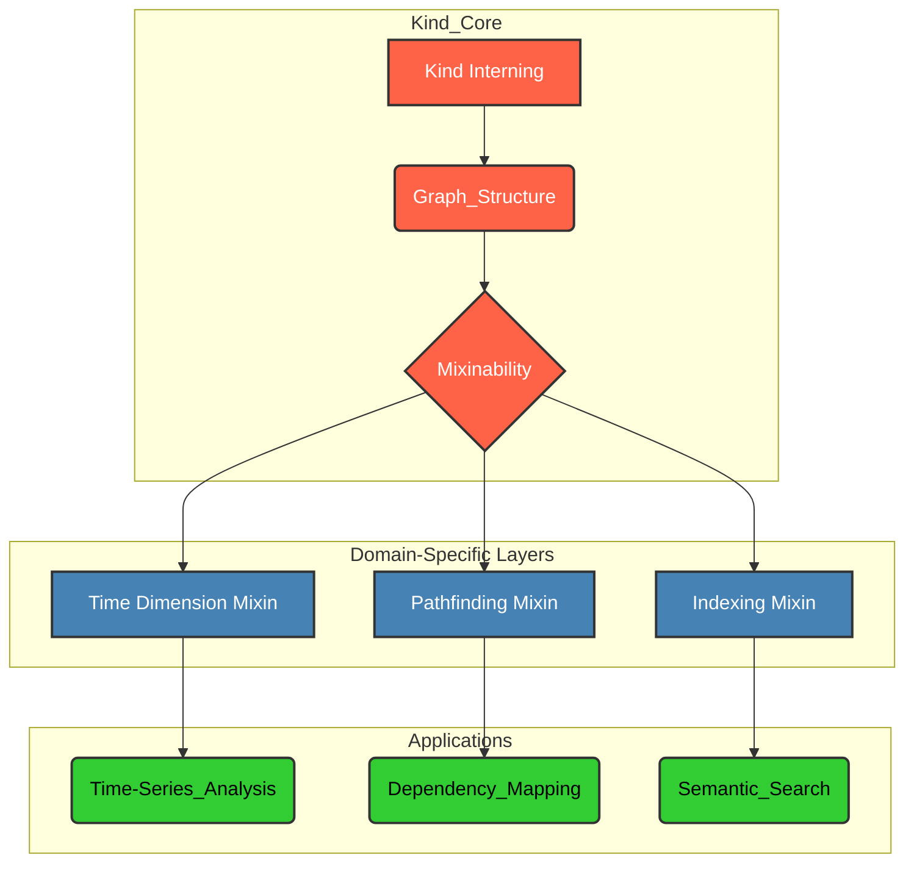

# `«kind»` Quick Guide

## A Foundational Primitive for Symbolic Systems

### Abstract

This document serves as a rapid introduction to `Kind`, a Python library designed as a foundational primitive for constructing sophisticated symbolic systems. Leveraging principles of interning, graph theory, and dynamic mixin-based extensibility, `Kind` facilitates the creation of highly modular, performant, and semantically rich data models. This guide is tailored for researchers and practitioners with a strong background in computer science, formal methods, or knowledge representation, aiming to provide a high-level understanding and immediate utility.

### 1. Core Concepts

#### 1.1. Kind Interning (Flyweight Pattern)

At its core, `Kind` implements a stringent interning mechanism. Every unique string name corresponds to precisely one `Kind` instance. This ensures referential equality (`is`) for semantically equivalent entities, optimizing memory usage and enabling O(1) lookup for symbolic identities.

```python

from kind.core.kind_namespace import k
from kind.core.kind import Kind

# Direct instantiation: Interning ensures uniqueness
kind_a = Kind("concept_A")
kind_b = Kind("concept_A")
assert kind_a is kind_b  # True: Same instance

# Namespace access: Convenient interning
kind_c = k.concept_C
kind_d = k.concept_C
assert kind_c is kind_d  # True: Same instance
```

#### 1.2. Graph-based Representation

`Kind` instances inherently function as nodes in a directed acyclic graph (DAG), or more generally, a directed graph. Relationships are established through explicit `append` or `add` operations, forming parent-child connections. This structure is fundamental for modeling hierarchical data, dependencies, and complex networks.

```python

from kind.core.kind_namespace import k

# Building a simple hierarchy
root_node = k.SystemRoot
sub_system_1 = k.SubSystem1
sub_system_2 = k.SubSystem2

root_node.append(sub_system_1)
root_node.append(sub_system_2)

# Accessing relationships
assert sub_system_1 in root_node.children
assert root_node in sub_system_1.parents
```

#### 1.3. Mixin-based Extensibility

`Kind`'s architecture supports dynamic runtime extension via mixins. This allows for the modular injection of domain-specific behaviors (e.g., time dimension parsing, pathfinding, indexing) without modifying the core `Kind` class. Time is opt-in: `import kind.time` attaches the time properties (`as_datetime`, `hour`, `time_head`, ...) to every Kind; without it a Kind has none. This pattern promotes a highly composable design, enabling researchers to tailor `Kind`'s capabilities precisely to their problem domain.

```python

import kind.time  # opt in to the time mixins
from kind.core.kind import Kind

# Time dimension mixin example
event_start = Kind("2023-10-26T10:00:00+00:00")
event_end = Kind("2023-10-26T11:30:00+00:00")

assert event_start.as_datetime.hour == 10
assert event_end.as_datetime.minute == 30
assert (event_end.as_datetime - event_start.as_datetime).total_seconds() == 5400.0  # 1 hour 30 minutes
```

#### 1.4. Lazy Evaluation & Performance Characteristics

Certain `Kind` operations, particularly those involving complex graph traversals or computations on large datasets, are designed with lazy evaluation principles. This defers computation until results are explicitly required, optimizing performance for scenarios where only subsets of data are accessed.

*   **O(1) Lookup:** Due to interning.
*   **O(1) Linking:** Appending/adding children.
*   **Traversal:** Performance depends on graph density and traversal algorithm (e.g., DFS/BFS).

### 2. Illustrative Architecture: Knowledge Graph Foundation

Consider `Kind` as the foundational layer for a dynamic knowledge graph. Each `Kind` represents an entity or concept, and their interconnections form the graph's structure. Mixins can then imbue these entities with domain-specific semantics and behaviors.



*   **Kind Core (Red):** Represents the fundamental, immutable aspects of `Kind` instances.
*   **Domain-Specific Layers (Steel Blue):** Illustrates how mixins extend `Kind` with specialized capabilities relevant to particular domains.
*   **Applications (Lime Green):** Shows how these extended `Kind` instances can be leveraged to build concrete applications.

### 3. Considerations for Researchers

*   **Formal Verification:** The stable identity of `Kind` instances (one instance per name), per-instance freezing (`kind.freeze()`, `kind.immute()`) and the explicit graph structure lend themselves well to formal verification techniques for system properties.
*   **Semantic Web Integration:** `Kind` can serve as a lightweight, in-memory RDF-like store, where `Kind` names are URIs and relationships form triples.
*   **Dynamic Systems Modeling:** The mixin architecture enables runtime adaptation of system behavior, crucial for simulating adaptive or self-organizing systems.
*   **Memory Footprint:** While interning optimizes for unique names, be mindful of the graph's overall memory consumption for extremely large-scale graphs. Each space's pool is strong: a `Kind` stays (state included) until `kind.delete()`, `Kind.forget(name)` or closing its `KindSpace` removes it, so memory grows with the number of names; cap a space with `KindSpace(max_kinds=N)` (`KindLimitError`) when names come from untrusted input, or build a temporary graph inside `with KindSpace():` so leaving the block drops it. `kind.footprint()` reports a Kind's size.

### 4. Advice to Engineers

1. **Model** your solution from **top to bottom** using Breadth-first search (BFS), this way you'll ensure that no high level abstraction wi'll be missing.
2. **Model** your solution **at detail** on the bottom. Choose low-level protocoral, non-protocoral and hybrid concepts then draft the conceptual zone they consists of.
3. **Review** high-level concepts, adapt and apply **takeaway lessons** observed at previous step. 

### Conclusion

`Kind` provides a robust and flexible foundation for building complex symbolic systems. Its design principles promote clarity, efficiency, and extensibility, making it an ideal tool for academic exploration and practical application in areas requiring sophisticated knowledge representation and graph-based reasoning. For deeper engagement, consult the detailed tutorials and API documentation.
