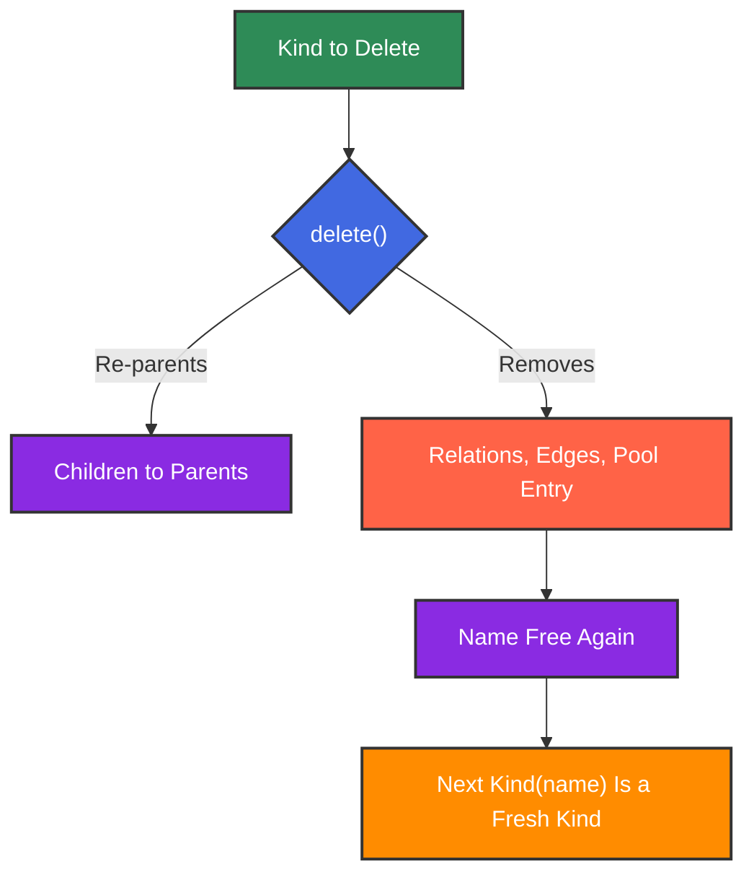

# Memory Awareness: Efficient Resource Management in Kind

The `Kind` framework is meticulously designed with memory efficiency as a core principle. In graph-based systems, managing memory effectively is paramount to scalability and performance, especially when dealing with a large number of interconnected entities. `Kind` employs several strategies to minimize its memory footprint and prevent common issues like memory leaks, ensuring robust and predictable behavior.

## Explicit Lifetime: a Strong Pool, `delete()` and `forget()`

The intern pool holds its Kinds strongly, like a Lisp or Ruby symbol table: a name stays the same entity, with all its state (origin, metadata, relations, elevated attributes), until `kind.delete()` or `Kind.forget(name)` removes it. Kinds are never collected behind your back. A weak pool would be invisible only for stateless values such as interned strings; a Kind carries state, so collecting it would silently lose data. The price is that memory grows with the number of names, so the lifetime of a Kind is explicit, and the pool can be capped.

### Mechanism
- **`BaseKind._pool`**: A plain `dict` from name to Kind, one for all classes. `Kind.len()` is `len(pool)`, O(1).
- **`Kind.delete()`**: Moves its children up to its parents, removes its relations in both directions, clears its parents and children, and removes it from the pool and from the creation-order tree. A later `Kind(name)` creates a fresh Kind.
- **`Kind.forget(name)`**: Deletes the Kind called `name` if there is one; returns `True` if there was, else `False`.
- **`Kind.max_kinds`** (`BaseKind.max_kinds`, default `None` = unbounded): caps the pool; creating a Kind beyond it raises `KindLimitError` (importable from `kind`). Set it when names come from untrusted input.

### Code Example
```python
from kind import Kind, KindLimitError

# Create some kinds and relationships
root = Kind('Root')
child1 = Kind('Child1')
child2 = Kind('Child2')

root.append(child1)
child1.append(child2)

print(f"Before delete: Root children: {[c.name for c in root.children]}")
print(f"Before delete: Child1 parents: {[p.name for p in child1.parents]}")

# Delete child1: Child2 moves up to Root
child1.delete()

print(f"After delete: Root children: {[c.name for c in root.children]}")
print(f"After delete: Child1 parents: {[p.name for p in child1.parents]}")
print(f"After delete: Kind('Child1') is child1? {Kind('Child1') is child1}")  # a new Kind

# The pool is strong: a Kind keeps its state with no variable referencing it
Kind('Temporary').metadata['note'] = 'kept'
print(f"Temporary still holds its state? {Kind('Temporary').metadata['note']}")
print(f"forget('Temporary'): {Kind.forget('Temporary')}, again: {Kind.forget('Temporary')}")

# Cap the pool when names come from untrusted input
Kind.max_kinds = Kind.len()
try:
    Kind('one-too-many')
except KindLimitError:
    print("KindLimitError: the pool is full")
finally:
    Kind.max_kinds = None
```
<details>
<summary>Outcome</summary>

```text
Before delete: Root children: ['Child1']
Before delete: Child1 parents: ['Root']
After delete: Root children: ['Child2']
After delete: Child1 parents: []
After delete: Kind('Child1') is child1? False
Temporary still holds its state? kept
forget('Temporary'): True, again: False
KindLimitError: the pool is full
```
</details>

### Diagram

## Proactive Memory Management for the `context` Attribute

The `Kind` class includes a `context` attribute, implemented as a `DefDict` (a `defaultdict` of `defaultdict`s), which allows for flexible storage of arbitrary, often transient, data associated with a `Kind` instance. It is created lazily on first access. To prevent memory accumulation from this dynamic storage, `Kind` provides `clear_context()`.

### Mechanism
- **`Kind.context`**: A `DefDict` for storing arbitrary contextual data.
- **`Kind.clear_context()`**: Empties the `context` `DefDict` (a no-op if it was never created), so the nested structures it held become unreferenced and eligible for garbage collection. A frozen Kind refuses it with `FrozenKindError`.
- **`deep_del(obj, attr)`** (in `kind.core.maturing`): A helper that deletes an attribute and, if its value is a mapping, empties it first; `clear_context()` does not need it.

### Code Example
```python
from kind import k

s = k.MyContextKind

# Add nested data to context
s.context['user']['preferences']['theme'] = 'dark'
s.context['session']['id'] = 'abc-123'
s.context['temp_data'] = [1, 2, 3]

print(f"Before clear_context: {sorted(s.context)}, theme={s.context['user']['preferences']['theme']}")

# Clear the context
s.clear_context()

print(f"After clear_context: {sorted(s.context)}")
```
<details>
<summary>Outcome</summary>

```text
Before clear_context: ['session', 'temp_data', 'user'], theme=dark
After clear_context: []
```
</details>

### Diagram

## Conclusion

Memory awareness is a fundamental aspect of the `Kind` framework's design, ensuring its suitability for high-performance and long-running applications. Through explicit lifetime (a strong intern pool, `delete()`/`forget()` and the `max_kinds` cap), lazily created parts, maturing and proactive management of dynamic attributes like `context`, `Kind` minimizes its memory footprint and contributes to overall system stability. This commitment to efficient resource management allows developers to build complex symbolic systems without undue concern for memory-related performance bottlenecks.

For a comprehensive overview of the Kind's memory awareness, refer to the [Memory Awareness Overview Diagram](memory_awareness_overview.mmd).

---
