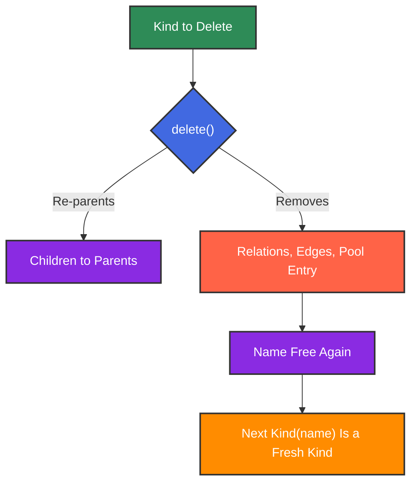
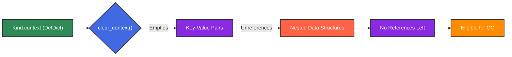

# Memory Awareness: Efficient Resource Management in Kind

The `Kind` framework is meticulously designed with memory efficiency as a core principle. In graph-based systems, managing memory effectively is paramount to scalability and performance, especially when dealing with a large number of interconnected entities. `Kind` employs several strategies to minimize its memory footprint and prevent common issues like memory leaks, ensuring robust and predictable behavior.

## Explicit Lifetime: Strong Pools in Spaces, `delete()` and `forget()`

Every Kind lives in a `KindSpace`: one universe of names with its own pool, creation order, counters, lock and size cap. `Kind(name)` looks the name up in the *current* space (a context variable). A process starts with a default space, so code that never mentions spaces behaves as one symbol table.

A space holds its Kinds strongly, like a Lisp or Ruby symbol table: a name stays the same entity, with all its state (origin, metadata, relations, elevated attributes), until `kind.delete()`, `Kind.forget(name)` or closing its space removes it. Kinds are never collected behind your back. A weak pool would be invisible only for stateless values such as interned strings; a Kind carries state, so collecting it would silently lose data. The price is that memory grows with the number of names, so the lifetime of a Kind is explicit, and a space can be capped or closed.

### Mechanism
- **`space.pool`**: A plain `dict` from name to Kind, shared by all Kind classes in that space. `Kind.len()` is `len(current_space())`, O(1); `Kind.len()`, `first()`, `last()`, `seek()`, `each()`, `next()`, `forget()` and `ps()` act on the current space.
- **`Kind.delete()`**: Moves its children up to its parents, removes its relations in both directions, clears its parents and children, and removes it from its space's pool and creation order. A later `Kind(name)` creates a fresh Kind.
- **`Kind.forget(name)`**: Deletes the Kind called `name` in the current space if there is one; returns `True` if there was, else `False`.
- **`KindSpace(max_kinds=N)`** (default `None` = unbounded): caps a space; creating a Kind beyond it raises `KindLimitError` (importable from `kind`). Use it when names come from untrusted input.
- **`with KindSpace(...) as space:`**: makes `space` current inside the block; leaving the block closes it and drops all its Kinds at once. A Kind still referenced afterwards stays readable, but any change to it raises `SpaceError`. The default space cannot be closed.

### Code Example
```python
from kind import Kind

# Create some kinds and relationships
root = Kind('Root')
child1 = Kind('Child1')
child2 = Kind('Child2')

root.append(child1)
child1.append(child2)

print(f"Before delete: Root children: {[c.name for c in root.children]}")
print(f"Before delete: Child1 parents: {[p.name for p in child1.parents]}")

# Delete child1: Child2 moves up to Root
child1.delete()

print(f"After delete: Root children: {[c.name for c in root.children]}")
print(f"After delete: Child1 parents: {[p.name for p in child1.parents]}")
print(f"After delete: Kind('Child1') is child1? {Kind('Child1') is child1}")  # a new Kind

# The pool is strong: a Kind keeps its state with no variable referencing it
Kind('Temporary').metadata['note'] = 'kept'
print(f"Temporary still holds its state? {Kind('Temporary').metadata['note']}")
print(f"forget('Temporary'): {Kind.forget('Temporary')}, again: {Kind.forget('Temporary')}")

```
<details>
<summary>Outcome</summary>

```text
Before delete: Root children: ['Child1']
Before delete: Child1 parents: ['Root']
After delete: Root children: ['Child2']
After delete: Child1 parents: []
After delete: Kind('Child1') is child1? False
Temporary still holds its state? kept
forget('Temporary'): True, again: False
```
</details>

### Diagram

## Spaces: Isolated, Disposable Universes of Names

A `KindSpace` scopes a graph: build it inside `with KindSpace():`, and leaving the block releases every Kind of it in O(1), without touching the default space. Equality is name *and* space, so `Kind('Stock')` inside a space is not the `Kind('Stock')` outside it, and an edge or relation across spaces raises `SpaceError` (it would make their lifetimes undefined). `kind.space` tells a Kind's space; each space has its own `RLock`.

The current space is a context variable: asyncio/trio tasks and anyio worker threads inherit it, while a thread started with `threading.Thread` sees the default space unless it runs its target with `contextvars.copy_context().run(...)`.

### Code Example
```python
import contextvars
import threading

from kind import Kind, KindLimitError, KindSpace, SpaceError, current_space

outer = Kind('Stock')
with KindSpace(max_kinds=2, name="scratch") as space:
    inner = Kind('Stock')                      # same name, another universe
    print(f"current space: {current_space()!r}")
    print(f"inner == outer? {inner == outer}, inner.space is space? {inner.space is space}")
    inner.append(Kind('Bond'))
    try:
        Kind('Option')                         # a third name in a space capped at 2
    except KindLimitError:
        print("KindLimitError: the space is full")
    try:
        outer.append(inner)                    # an edge across spaces
    except SpaceError:
        print("SpaceError: edges cannot cross spaces")
    seen = []
    record = lambda: seen.append(current_space().name)
    for thread in (threading.Thread(target=record),                     # sees the default space
                   threading.Thread(target=contextvars.copy_context().run, args=(record,))):
        thread.start()
        thread.join()
    print(f"plain thread / copied context: {seen}")
print(f"after the block: {space!r}, Kind('Stock') is outer? {Kind('Stock') is outer}")
try:
    inner.relate(inner.children[0], how='holds')  # reading is fine; changing is not
except SpaceError:
    print(f"SpaceError: {inner.name!r} is readable ({[c.name for c in inner.children]}) but its space is closed")
```
<details>
<summary>Outcome</summary>

```text
current space: KindSpace('scratch', 1 kinds)
inner == outer? False, inner.space is space? True
KindLimitError: the space is full
SpaceError: edges cannot cross spaces
plain thread / copied context: ['default', 'scratch']
after the block: KindSpace('scratch', closed), Kind('Stock') is outer? True
SpaceError: 'Stock' is readable (['Bond']) but its space is closed
```
</details>

## Proactive Memory Management for the `context` Attribute

The `Kind` class includes a `context` attribute, implemented as a `DefDict` (a `defaultdict` of `defaultdict`s), which allows for flexible storage of arbitrary, often transient, data associated with a `Kind` instance. It is created lazily on first access. To prevent memory accumulation from this dynamic storage, `Kind` provides `clear_context()`.

### Mechanism
- **`Kind.context`**: A `DefDict` for storing arbitrary contextual data.
- **`Kind.clear_context()`**: Empties the `context` `DefDict` (a no-op if it was never created), so the nested structures it held become unreferenced and eligible for garbage collection. A frozen Kind refuses it with `FrozenKindError`.
- **`deep_del(obj, attr)`** (in `kind.core.maturing`): A helper that deletes an attribute and, if its value is a mapping, empties it first; `clear_context()` does not need it.

### Code Example
```python
from kind import k

s = k.MyContextKind

# Add nested data to context
s.context['user']['preferences']['theme'] = 'dark'
s.context['session']['id'] = 'abc-123'
s.context['temp_data'] = [1, 2, 3]

print(f"Before clear_context: {sorted(s.context)}, theme={s.context['user']['preferences']['theme']}")

# Clear the context
s.clear_context()

print(f"After clear_context: {sorted(s.context)}")
```
<details>
<summary>Outcome</summary>

```text
Before clear_context: ['session', 'temp_data', 'user'], theme=dark
After clear_context: []
```
</details>

### Diagram

## Conclusion

Memory awareness is a fundamental aspect of the `Kind` framework's design, ensuring its suitability for high-performance and long-running applications. Through explicit lifetime (strong pools in disposable `KindSpace`s, `delete()`/`forget()` and the `max_kinds` cap), lazily created parts, maturing and proactive management of dynamic attributes like `context`, `Kind` minimizes its memory footprint and contributes to overall system stability. This commitment to efficient resource management allows developers to build complex symbolic systems without undue concern for memory-related performance bottlenecks.

For a comprehensive overview of the Kind's memory awareness, refer to the [Memory Awareness Overview Diagram](memory_awareness_overview.mmd).

---
