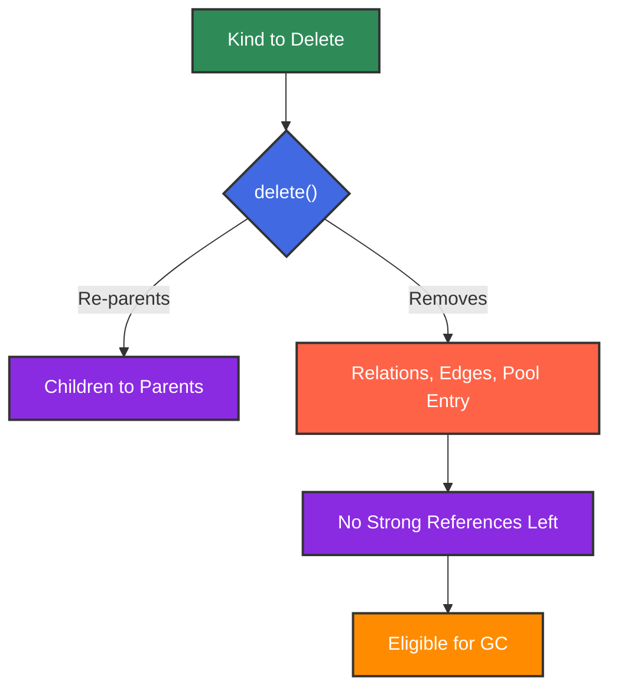

# Memory Awareness: Efficient Resource Management in Kind

The `Kind` framework is meticulously designed with memory efficiency as a core principle. In graph-based systems, managing memory effectively is paramount to scalability and performance, especially when dealing with a large number of interconnected entities. `Kind` employs several strategies to minimize its memory footprint and prevent common issues like memory leaks, ensuring robust and predictable behavior.

## GC-aware Deletion and the Weak Pool

`Kind` relies on Python's garbage collection (GC) to release resources when they are no longer needed. The intern pool is weak: it does not keep a Kind alive, so a Kind that nothing references is collected, and a later `Kind(name)` creates a fresh one. The `delete()` method, when invoked on a `Kind` instance, severs its explicit connections and removes it from the pool; Python's GC handles the deallocation.

### Mechanism
- **`BaseKind._pool`**: A `weakref.WeakValueDictionary`, one for all classes; it holds Kinds only while something else references them. Children, parents and relations are strong references, so a Kind reachable from a referenced Kind stays alive.
- **`Kind.delete()`**: Moves its children up to its parents, removes its relations in both directions, clears its parents and children, and removes it from the pool and from the creation-order tree.
- **No forced collection**: the library does not call `gc.collect()`; breaking references is enough for reference counting, and the cycle collector handles the rest.

### Code Example
```python
import gc
from kind import Kind

# Create some kinds and relationships
root = Kind('Root')
child1 = Kind('Child1')
child2 = Kind('Child2')

root.append(child1)
child1.append(child2)

print(f"Before delete: Root children: {[c.name for c in root.children]}")
print(f"Before delete: Child1 parents: {[p.name for p in child1.parents]}")

# Delete child1: Child2 moves up to Root
child1.delete()

print(f"After delete: Root children: {[c.name for c in root.children]}")
print(f"After delete: Child1 parents: {[p.name for p in child1.parents]}")
print(f"After delete: Kind('Child1') is child1? {Kind('Child1') is child1}")  # a new Kind

# The pool is weak: a Kind nobody references is collected
live = Kind.len()
Kind('Temporary')
gc.collect()  # not needed under reference counting; makes the example explicit
print(f"Temporary kept alive by the pool? {Kind.len() > live}")
```
<details>
<summary>Outcome</summary>

```text
Before delete: Root children: ['Child1']
Before delete: Child1 parents: ['Root']
After delete: Root children: ['Child2']
After delete: Child1 parents: []
After delete: Kind('Child1') is child1? False
Temporary kept alive by the pool? False
```
</details>

### Diagram

## Proactive Memory Management for the `context` Attribute

The `Kind` class includes a `context` attribute, implemented as a `DefDict` (a `defaultdict` of `defaultdict`s), which allows for flexible storage of arbitrary, often transient, data associated with a `Kind` instance. It is created lazily on first access. To prevent memory accumulation from this dynamic storage, `Kind` provides `clear_context()`.

### Mechanism
- **`Kind.context`**: A `DefDict` for storing arbitrary contextual data.
- **`Kind.clear_context()`**: Empties the `context` `DefDict` (a no-op if it was never created), so the nested structures it held become unreferenced and eligible for garbage collection. A frozen Kind refuses it with `FrozenKindError`.
- **`deep_del(obj, attr)`** (in `kind.core.maturing`): A helper that deletes an attribute and, if its value is a mapping, empties it first; `clear_context()` does not need it.

### Code Example
```python
from kind import k

s = k.MyContextKind

# Add nested data to context
s.context['user']['preferences']['theme'] = 'dark'
s.context['session']['id'] = 'abc-123'
s.context['temp_data'] = [1, 2, 3]

print(f"Before clear_context: {sorted(s.context)}, theme={s.context['user']['preferences']['theme']}")

# Clear the context
s.clear_context()

print(f"After clear_context: {sorted(s.context)}")
```
<details>
<summary>Outcome</summary>

```text
Before clear_context: ['session', 'temp_data', 'user'], theme=dark
After clear_context: []
```
</details>

### Diagram

## Conclusion

Memory awareness is a fundamental aspect of the `Kind` framework's design, ensuring its suitability for high-performance and long-running applications. Through a weak intern pool, GC-aware deletion and proactive management of dynamic attributes like `context`, `Kind` minimizes its memory footprint and contributes to overall system stability. This commitment to efficient resource management allows developers to build complex symbolic systems without undue concern for memory-related performance bottlenecks.

For a comprehensive overview of the Kind's memory awareness, refer to the [Memory Awareness Overview Diagram](memory_awareness_overview.mmd).

---
