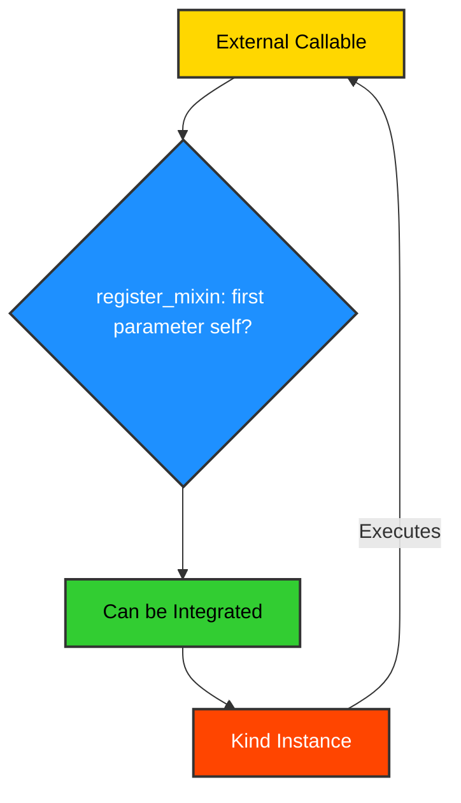
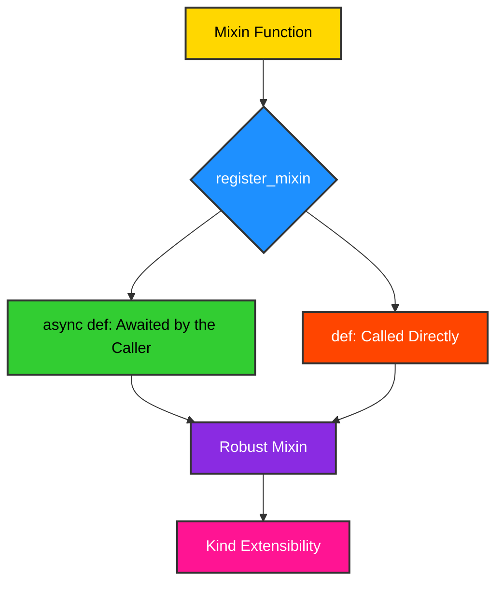
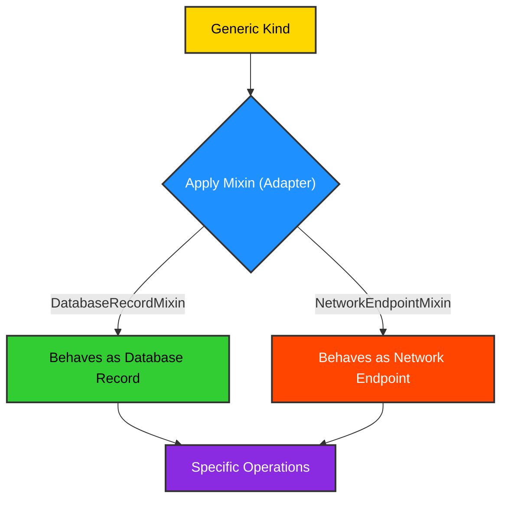
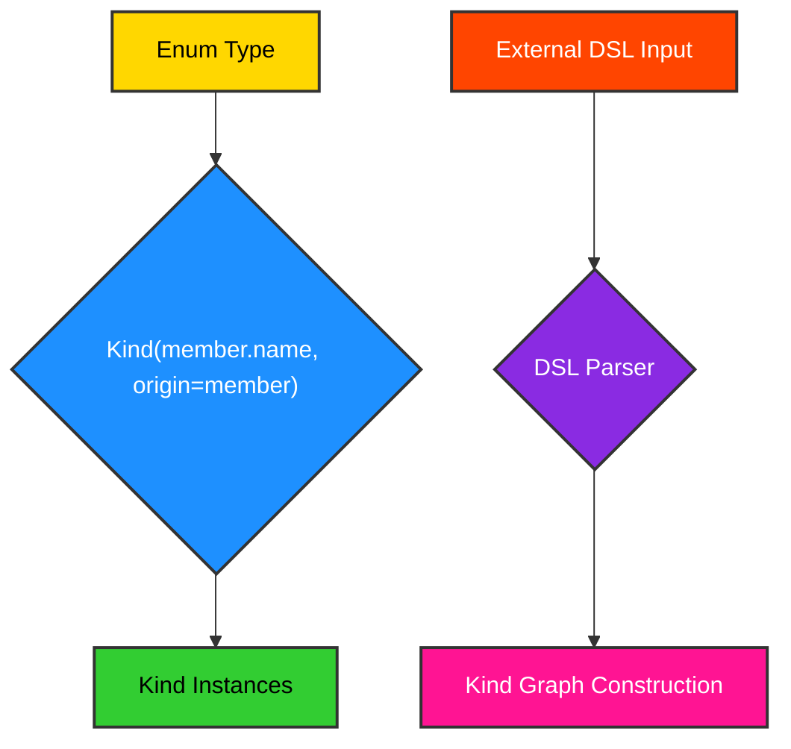

# Extensibility: Adapting Kind to Diverse Domains

The `Kind` framework is designed with a strong emphasis on extensibility, allowing it to be adapted and integrated into a wide array of applications and domains. This extensibility is achieved through dynamic mixin capabilities, protocols for the builtin mixins (`kind.core.protocols`), and compatibility with external data formats like enum reflections and Domain-Specific Languages (DSLs).

## Callable Integration Through Mixins

There is no separate `Kindable` type: the contract for integrating a callable into `Kind` is the mixin contract. A function whose first parameter is `self` (or a class or module, expanded into its public members) is registered with `register_mixin` and becomes a method of every Kind. This promotes a clean separation of concerns, allowing complex behaviors to be encapsulated in external modules while still being accessible and manageable through `Kind`.

### Purpose and Usage
To ensure that any callable object can be consistently used within the `Kind` framework, particularly when dynamically attaching behaviors or processing data.

### Code Example
```python
from kind import Kind
from kind.core.mixinability import register_mixin

class LogActionMixin:
    def log_message(self, message: str):
        print(f"[LOG] {message}")

class CalculateSumMixin:
    def calculate_sum(self, a: int, b: int) -> int:
        return a + b

# Register mixins
register_mixin(LogActionMixin, expand=True)
register_mixin(CalculateSumMixin, expand=True)

log_kind = Kind('Logger')
calc_kind = Kind('Calculator')

# Using the integrated callables
log_kind.log_message("Application started.")
result = calc_kind.calculate_sum(10, 20)
print(f"Calculation result: {result}")
```
<details>
<summary>Outcome</summary>

```text
[LOG] Application started.
Calculation result: 30
```
</details>

### Diagram

## Asynchronous Mixins

There is no separate `MixinFunction` protocol: a mixin method may be `async`, and callers await it like any coroutine method. Where the work runs (event loop, worker thread) is the caller's choice, e.g. `anyio.to_thread.run_sync` (or `process_batch` from the separate `kind-scheduler` distribution); mixins take no `new_process`/`new_thread` flags.

### Purpose and Usage
To extend `Kind` with asynchronous operations, such as I/O-bound fetches.

### Code Example
```python
from kind import Kind
from kind.core.mixinability import register_mixin
import asyncio

# An asynchronous mixin method
class AsyncDataFetcher:
    async def fetch_data(self, url: str) -> str:
        print(f"{self.name}: fetching data from {url}")
        await asyncio.sleep(0.1) # Simulate async I/O
        return f"Data from {url}"

# Register the mixin
register_mixin(AsyncDataFetcher, expand=True)

# Use the mixin
async def main():
    web_kind = Kind('WebResource')
    data = await web_kind.fetch_data("https://example.com")
    print(data)

if __name__ == "__main__":
    asyncio.run(main())
```
<details>
<summary>Outcome</summary>

```text
WebResource: fetching data from https://example.com
Data from https://example.com
```
</details>

### Diagram

## Adapters Through Mixins Enable Different Logical Structures

There is no `KindAdapter` class; the adapter idea is realized through the framework's mixinability. This allows `Kind` instances to dynamically adopt different logical structures or behaviors, effectively acting as adapters for various data models or interaction patterns. By applying specific mixins, a generic `Kind` can be transformed to behave like a database record, a network endpoint, or a UI component, without altering its core identity. `register_mixin` adds the behavior to every Kind; `apply_mixin_to_instance(kind, mixin)` adds it to one Kind only.

### Purpose and Usage
To dynamically change the logical interpretation or behavior of a `Kind` instance by applying specific mixins. This enables a single `Kind` to represent different types of entities based on context.

### Code Example

```python
from kind import Kind
from kind.core.mixinability import register_mixin
from kind.builtin import apply_builtins


# Define mixins for different logical structures
class DatabaseRecordMixin:
    def save(self):
        print(f"Saving {self.name} as a database record.")

    def load(self):
        print(f"Loading {self.name} from database.")


class NetworkEndpointMixin:
    def send_request(self, data):
        print(f"Sending request from {self.name} with data: {data}")

    def receive_response(self):
        print(f"Receiving response for {self.name}.")


# Register mixins
register_mixin(DatabaseRecordMixin, expand=True)
register_mixin(NetworkEndpointMixin, expand=True)

apply_builtins()

# Create a kind and apply behaviors dynamically
db_entity = Kind('UserAccount')
db_entity.save()
db_entity.load()

network_node = Kind('API_Gateway')
network_node.send_request({"query": "status"})
network_node.receive_response()
```
<details>
<summary>Outcome</summary>

```text
Saving UserAccount as a database record.
Loading UserAccount from database.
Sending request from API_Gateway with data: {'query': 'status'}
Receiving response for API_Gateway.
```
</details>

### Diagram

## Compatible with Enum Reflection and External DSL Inputs

The `Kind` framework's extensibility extends to its compatibility with external data sources and declarative formats. It can integrate with Python's `enum` types through reflection: each member becomes a `Kind` named after it, with the member as its `origin`. (There is no `Kind.from_enum`; `Kind.from_object` / `to_kind` convert values: scalars to the Kind of their text, containers to a Kind named by their content.) Furthermore, its flexible design enables the ingestion and interpretation of external Domain-Specific Language (DSL) inputs, facilitating the definition of complex symbolic structures and relationships using declarative syntax.

### Purpose and Usage
To easily convert `enum` members into `Kind` instances and to allow external DSLs to define `Kind` structures, enhancing interoperability and declarative modeling.

### Code Example

```python
from kind import Kind
import enum
from kind.builtin import apply_builtins

apply_builtins()


# Enum Reflection
class TrafficLight(enum.Enum):
    RED = 1
    YELLOW = 2
    GREEN = 3


# Convert enum members to Kinds, keeping each member as the origin
traffic_kinds = [Kind(member.name, origin=member) for member in TrafficLight]
for kind in traffic_kinds:
    print(f"Enum Kind: {kind.name} (origin: {kind.origin})")


def parse_dsl(dsl_string: str):
    kinds = {}
    for line in dsl_string.split(','):
        parts = line.strip().split('->')
        if len(parts) == 2:
            source_name = parts[0].strip()
            target_name = parts[1].strip()
            source_kind = kinds.get(source_name, Kind(source_name))
            target_kind = kinds.get(target_name, Kind(target_name))
            source_kind.append(target_kind)
            kinds[source_name] = source_kind
            kinds[target_name] = target_kind
    return kinds


dsl_input = "user -> post, post -> comment, user -> like"
parsed_kinds = parse_dsl(dsl_input)

user_kind = parsed_kinds['user']
print("\nDSL-defined graph:")  # tree(): depth first, children by name
for kind in user_kind.tree():
    print(kind.name)
```
<details>
<summary>Outcome</summary>

```text
Enum Kind: RED (origin: TrafficLight.RED)
Enum Kind: YELLOW (origin: TrafficLight.YELLOW)
Enum Kind: GREEN (origin: TrafficLight.GREEN)

DSL-defined graph:
user
like
post
comment
```
</details>

### Diagram

## Conclusion

The `Kind` framework's commitment to extensibility empowers developers to build highly adaptable and interoperable systems. By providing a clear mixin contract for callable integration, synchronous and asynchronous mixins, and seamless compatibility with external data formats, `Kind` facilitates the creation of flexible, domain-specific solutions that can evolve with changing requirements. This design philosophy ensures that `Kind` remains a versatile tool for a wide range of symbolic data manipulation tasks.

For a comprehensive overview of the Kind's extensibility, refer to the [Extensibility Overview Diagram](extensibility_overview.mmd).

--
