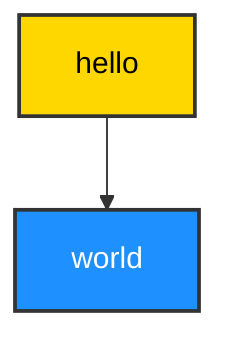
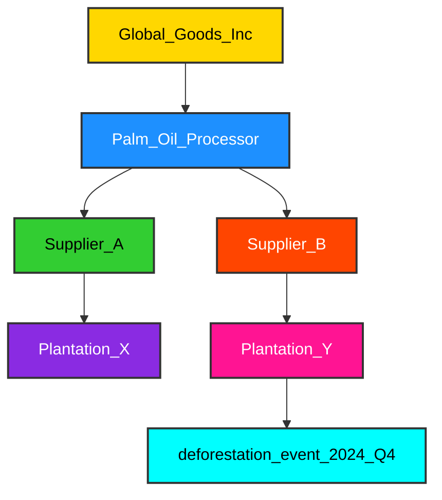
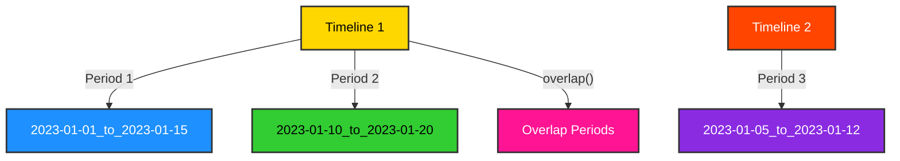
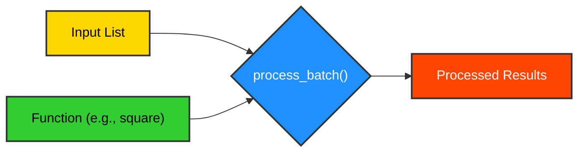
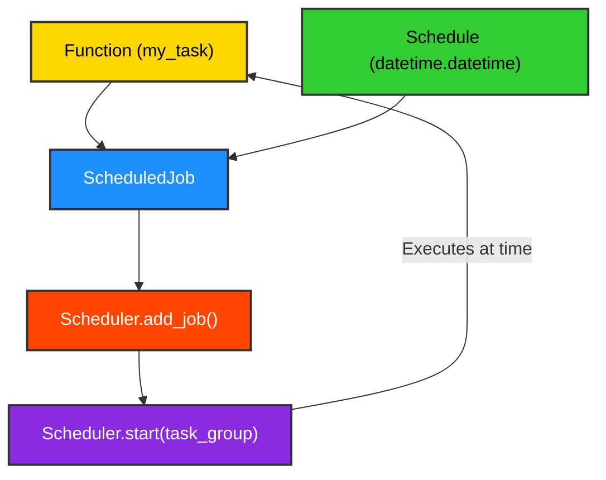

# Example Use: Practical Applications of the Kind Framework

The `Kind` framework is designed to be versatile, providing a powerful foundation for a wide range of applications that benefit from graph-based data structures and symbolic manipulation. This section illustrates several practical use cases, demonstrating how `Kind`'s core features can be leveraged to solve real-world problems.

## Basic Kind Creation and Relationships

This example demonstrates the fundamental operations of creating `Kind` instances and establishing basic parent-child relationships. It showcases the simplicity of defining a graph structure using `Kind` and the `add()` method.

### Code Example
```python
from kind import k, Kind

# --- Basic Kind creation and relationships ---
hello = Kind('hello')
world = k.world
hello.add(world)
print(hello.tree())
```
<details>
<summary>Outcome</summary>

```text
[Kind('hello'), Kind('world')]
```
</details>

### Explanation
- `Kind('hello')`: Creates a `Kind` instance named 'hello'. Due to the interning mechanism, if 'hello' already exists (and is still referenced: the pool is weak), the existing instance is returned.
- `k.world`: Utilizes the `KindNamespace` (`k`) for a more concise way to create a `Kind` named 'world'. This is syntactic sugar for `Kind('world')`.
- `hello.add(world)`: Establishes a directed relationship from `hello` to `world`, making `world` a child of `hello`. If the relationship already exists, it's idempotent.
- `print(hello.tree())`: Performs a depth-first traversal of `hello` and its descendants (children only) and prints the resulting list of kinds.

### Diagram

## ESG Example: Tracking Deforestation in a Supply Chain

This example illustrates how `Kind` can model complex supply chain relationships and track specific events, such as deforestation. It demonstrates the ability to build a graph representing entities and their connections, and then query this graph to identify paths that lead to undesirable events.

### Code Example

```python
from kind import k, Kind
from kind.core.mixinability import register_mixin
from kind.builtin import apply_builtins


class SupplyChainMixin:
    def buys_from(self, supplier: Kind):
        self.add(supplier)

    def sources_from(self, source: Kind):
        self.add(source)


register_mixin(SupplyChainMixin, expand=True)
apply_builtins()

k.Global_Goods_Inc.buys_from(k.Palm_Oil_Processor)
k.Palm_Oil_Processor.buys_from(k.Supplier_A)
k.Palm_Oil_Processor.buys_from(k.Supplier_B)
k.Supplier_A.sources_from(k.Plantation_X)
k.Supplier_B.sources_from(k.Plantation_Y)
k.Plantation_Y.add(k.deforestation_event_2024_Q4)


def has_deforestation(kind):
    return 'deforestation' in kind.name


for event in k.Global_Goods_Inc.match(has_deforestation):
    print(f"Deforestation Link Found: {k.Global_Goods_Inc.path_to(event)}")
```
<details>
<summary>Outcome</summary>

```text
Deforestation Link Found: [Kind('Global_Goods_Inc'), Kind('Palm_Oil_Processor'), Kind('Supplier_B'), Kind('Plantation_Y'), Kind('deforestation_event_2024_Q4')]
```
</details>

### Explanation
- **Supply Chain Modeling**: Each entity (e.g., `Global_Goods_Inc`, `Palm_Oil_Processor`, `Plantation_X`) is represented as a `Kind`. Relationships like `buys_from` and `sources_from` are established using custom mixin methods that call `add()`; a named relation would use `relate(other, how=...)`.
- **Event Representation**: `k.deforestation_event_2024_Q4` is a `Kind` representing a specific event, linked to `Plantation_Y`.
- **Graph Querying**: The `has_deforestation` function acts as a predicate to identify kinds related to deforestation. `k.Global_Goods_Inc.match(has_deforestation)` traverses the children of `Global_Goods_Inc` (depth first by default; `traversal='bfs'` for breadth first) and yields every kind satisfying the predicate.
- `k.Global_Goods_Inc.path_to(event)`: For each match, this method returns the sequence of kinds (following children links) from the starting point to the deforestation event, providing traceability.

### Diagram

## Timeline Example

This example showcases the use of `kind.builtin.timeline` to manage and analyze temporal data. It demonstrates how to create timelines, add time periods, and perform operations like finding overlaps between different timelines.

### Code Example

```python
from kind.builtin.timeline import Timeline
import datetime

timeline1 = Timeline()
timeline1.add_period(datetime.datetime(2023, 1, 1), datetime.datetime(2023, 1, 15))
timeline1.add_period(datetime.datetime(2023, 1, 10), datetime.datetime(2023, 1, 20))

timeline2 = Timeline()
timeline2.add_period(datetime.datetime(2023, 1, 5), datetime.datetime(2023, 1, 12))

overlap_timeline = timeline1.overlap(timeline2)
print(f"Overlap periods: {list(overlap_timeline)}")
print(timeline1.to_ascii())
```
<details>
<summary>Outcome</summary>

```text
Overlap periods: [(datetime.datetime(2023, 1, 5, 0, 0), datetime.datetime(2023, 1, 12, 0, 0)), (datetime.datetime(2023, 1, 10, 0, 0), datetime.datetime(2023, 1, 12, 0, 0))]
###################-
```
</details>

### Explanation
- `Timeline()`: Instantiates a `Timeline` object, a sorted list of time intervals that can be associated with a Kind (it is not itself a Kind).
- `add_period()`: Adds a time period (defined by start and end `datetime.datetime` objects) to the timeline. These periods are kept as sorted `(start, end)` tuples; overlapping periods are not merged.
- `overlap()`: A method provided by the `Timeline` class that returns a new `Timeline` of the common periods of two timelines (one per overlapping pair). This demonstrates `Kind`'s ability to extend its core functionality for domain-specific operations.
- `to_ascii()`: Visualizes the timeline using ASCII art (one character per day by default: `#` covered, `-` not), providing a quick textual representation of the time periods.

### Diagram

## Batch Processing Example

This example demonstrates a simple batch processing utility, showcasing how `Kind` can be used in conjunction with functional programming paradigms to apply a given function to a collection of inputs. While `Kind` itself is not a batch processing engine, its extensibility allows for the integration of such utilities.

### Code Example
```python
from kind.core.batch_processing import process_batch

def square(x): return x * x
results = process_batch([1, 2, 3, 4], square)
print(f"Batch processing results: {results}")
```
<details>
<summary>Outcome</summary>

```text
Batch processing results: [1, 4, 9, 16]
```
</details>

### Explanation
- `process_batch(batch, func, new_thread=True)`: A utility function from `kind.core.batch_processing` (also exported as `kind.process_batch`) that applies the function to each input concurrently in worker threads (or in order in the calling thread with `new_thread=False`) and returns the results in input order; `a_process_batch(batch, func)` is its async form. This highlights how `Kind` can be part of a larger system, where its symbolic representations can be processed by external functions.
- `square()`: A simple function demonstrating the type of operation that can be applied in a batch.

### Diagram

## Scheduler Example

This example demonstrates the use of `kind.core.schedule` to schedule and execute tasks at specified times. It showcases the `Scheduler` and `ScheduledJob` classes, allowing for the automation of functions based on time dimension objects.

### Code Example
```python
import datetime

import anyio

from kind.core.schedule import ScheduledJob, Scheduler

def my_task(message):
    print(f"Executing task: {message}")

async def main():
    scheduler = Scheduler()
    job = ScheduledJob(my_task, args=("Hello from the scheduler!",),
                       schedule=datetime.datetime.now() + datetime.timedelta(seconds=1))
    scheduler.add_job(job)

    async with anyio.create_task_group() as task_group:
        await scheduler.start(task_group)
        await anyio.sleep(2)  # wait for the job to run
        await scheduler.stop()

anyio.run(main)
```
<details>
<summary>Outcome</summary>

```text
Executing task: Hello from the scheduler!
```
</details>

### Explanation
- `Scheduler()`: Initializes the scheduler (`Scheduler(schedule_file=None, allowed_modules=(), now=datetime.datetime.now)`); schedule files may only name functions from `allowed_modules`.
- `ScheduledJob()`: Creates a job object, specifying the function to run (`my_task`), its arguments, and the `schedule` (in this case, 1 second from now).
- `scheduler.add_job(job)`: Adds the created job to the scheduler's queue.
- `await scheduler.start(task_group)`: Starts the scheduler's execution loop as a task in an `anyio` task group; sync jobs run in a worker thread.
- `anyio.sleep()`: Lets the loop run the scheduled task; `await scheduler.run_due_jobs()` would run one deterministic step instead.
- `await scheduler.stop()`: Halts the scheduler's execution loop.

### Diagram

## Conclusion

These examples collectively demonstrate the versatility and power of the `Kind` framework. From basic graph construction to complex supply chain analysis, temporal data management, batch processing, and task scheduling, `Kind` provides a flexible and efficient foundation for building sophisticated applications. Its modular design and extensibility allow developers to tailor its capabilities to specific domain requirements, making it a valuable tool for a wide array of symbolic data manipulation tasks.

---
