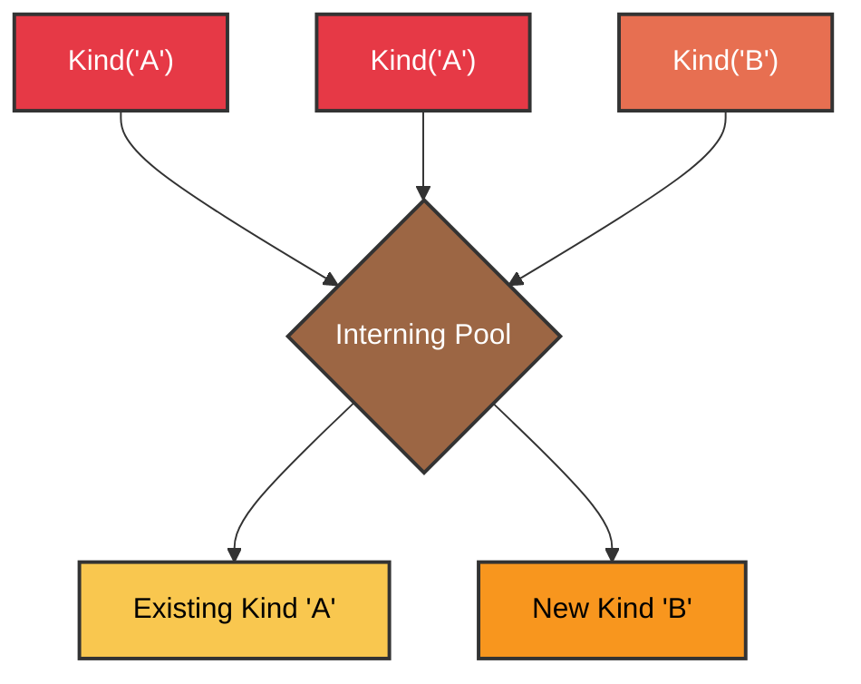
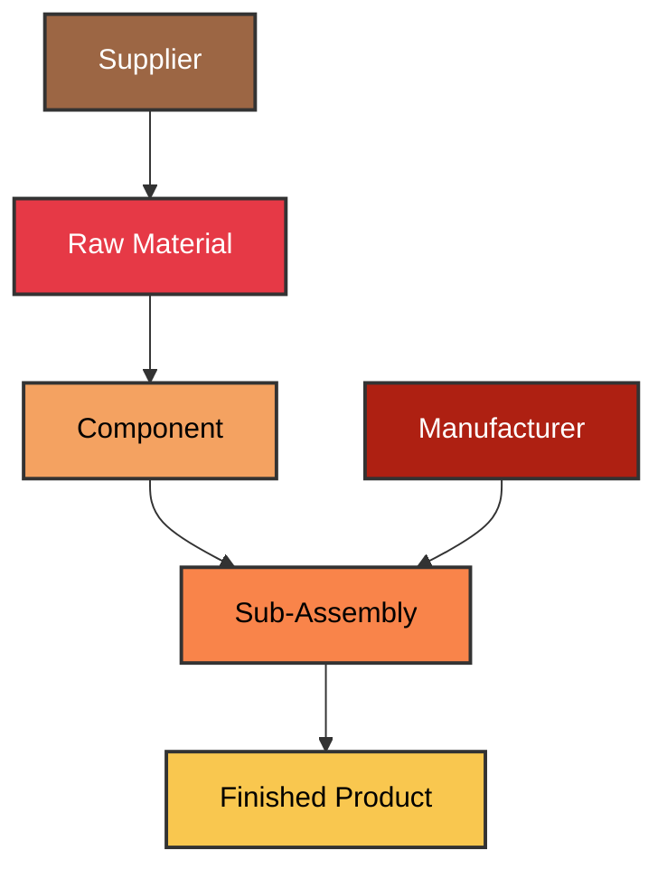
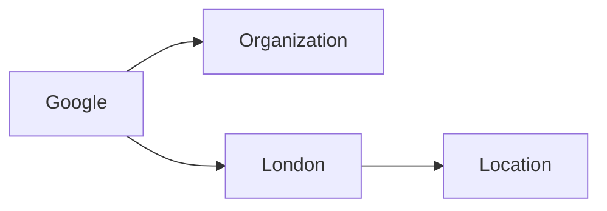

# `«kind»`

> - Imagine `kind` like a pointer that does not point to anything. 
> - Imagine `kinds` as a knowledge meta-network layer that represent semantic information about your entities and objects.

# 1.1 Kind: The Fundamental Building Block

The `Kind` object serves as the atomic unit within the framework, embodying a node in a dynamic, directed acyclic graph (DAG). Its design prioritizes uniqueness, efficient relationship management, and extensibility, making it a versatile primitive for diverse symbolic data manipulation tasks.

## Uniqueness and Interning

Each `Kind` instance is uniquely identified by its `name` attribute. This uniqueness is enforced through an interning mechanism, ensuring that `Kind('A')` returns the same object in memory as any subsequent call to `Kind('A')` in the same `KindSpace`. The name is looked up in the current space (a process starts with one default space; `with KindSpace():` opens another, and equality is name *and* space). The space's pool is strong: a name stays the same Kind, state included, until `delete()`, `Kind.forget(name)` or closing the space removes it. This design choice offers significant advantages:

-   **Memory Efficiency**: Prevents redundant object creation, reducing memory footprint, especially in large graphs with many identical symbolic representations.
-   **Consistency**: Guarantees that operations on a kind consistently refer to the same underlying entity, simplifying identity checks and graph integrity.
-   **Performance**: Accelerates lookups and comparisons, as identity can often be checked by memory address rather than content comparison.



## Complex Relationships and Graph Structure

`Kind` objects are designed to form complex relationships, acting as nodes in a directed acyclic graph (DAG). Each `Kind` maintains references to its `children` (kinds it points to) and `parents` (kinds that point to it). This bidirectional linking facilitates efficient traversal and manipulation of the graph structure.

The framework provides intuitive methods for establishing and managing these relationships:

-   `kind.append(child)`: Establishes a directed relationship from `kind` to `child` (idempotent: `children` is an `OrderedKindSet`, ordered, without duplicates) and returns `child`.
-   `kind.add(child)`: Like `append`, but returns `kind`, so calls can be chained.
-   `kind.delete()`: Removes a kind from the graph and its space's pool; its children move up to its parents.

### Illustrative Example: Supply Chain Modeling

Consider a supply chain where raw materials are transformed into finished goods. Each entity (e.g., "Supplier", "Manufacturer", "Product") can be represented as a `Kind`. Relationships like "supplies", "manufactures", or "contains" can be modeled by connecting these kinds.


### Code Example: Building a Simple Knowledge Graph

```python
from kind import Kind, k

# Create kinds for entities
person = Kind('Person')
organization = Kind('Organization')
event = Kind('Event')
location = Kind('Location')

# Create specific instances
alice = k.Alice
bob = k.Bob
google = k.Google
conference = k.Tech_Conference_2025
london = k.London

# Establish relationships
alice.add(person)
bob.add(person)
google.add(organization)
conference.add(event)
london.add(location)

alice.add(google) # Alice works at Google
google.add(london) # Google has an office in London
alice.add(conference) # Alice attends the conference
conference.add(london) # Conference is in London

# Traverse and visualize
print(alice.to_ascii())
print()
print(google.to_mmd())
```
<details>
<summary>Outcome</summary>

```text
- Alice
  - Google
    - London
      - Location
      - Tech_Conference_2025
        - Event
    - Organization
  - Person
    - Bob

graph LR
Google[Google]
Location[Location]
London[London]
Organization[Organization]
    Google --> Organization
    Google --> London
    London --> Location
```

`to_ascii()` walks children and then parents (`family_mode='children_first'`), by name within each group, so `London`'s other parent `Tech_Conference_2025` and `Person`'s other parent `Bob` appear too.

**Rendered Mermaid Diagram:**


</details>

### Industry Applications

**High-Tech: Semantic Web and Knowledge Graphs**

```python
from kind import k, Kind
from kind.core.mixinability import register_mixin
from kind.builtin import apply_builtins


class KnowledgeGraphMixin:
    def has_title(self, title: Kind):
        self.add(title)

    def has_author(self, author: Kind):
        self.add(author)

    def published_in(self, journal: Kind):
        self.add(journal)

    def affiliated_with(self, organization: Kind):
        self.add(organization)

    def contains(self, component: Kind):
        self.add(component)


register_mixin(KnowledgeGraphMixin, expand=True)
apply_builtins()

# Representing a research paper and its attributes
k.Paper_A.has_title(k.The_Future_of_AI)
k.Paper_A.has_author(k.Alice_Smith)
k.Paper_A.published_in(k.Journal_of_AI_Research)
k.Alice_Smith.affiliated_with(k.University_X)

print(f"Paper A title: {k.Paper_A.children[0].name}")
print(f"Author of Paper A: {k.Paper_A.children[1].name}")
```
<details>
<summary>Outcome</summary>

```text
Paper A title: The_Future_of_AI
Author of Paper A: Alice_Smith
```
</details>

**Low-Tech: Inventory Management and Bill of Materials (BOM)**

```python
from kind import k, Kind
from kind.core.mixinability import register_mixin
from kind.builtin import apply_builtins


class KnowledgeGraphMixin:
    def has_title(self, title: Kind):
        self.add(title)

    def has_author(self, author: Kind):
        self.add(author)

    def published_in(self, journal: Kind):
        self.add(journal)

    def affiliated_with(self, organization: Kind):
        self.add(organization)

    def contains(self, component: Kind):
        self.add(component)


register_mixin(KnowledgeGraphMixin, expand=True)
apply_builtins()

# Modeling a bicycle BOM
k.Bicycle.contains(k.Frame)
k.Bicycle.contains(k.Wheel_Assembly)
k.Bicycle.contains(k.Handlebars)
k.Wheel_Assembly.contains(k.Rim)
k.Wheel_Assembly.contains(k.Spokes)
k.Wheel_Assembly.contains(k.Tire)

print(f"Bicycle components: {[c.name for c in k.Bicycle.children]}")
print(f"Wheel Assembly components: {[c.name for c in k.Wheel_Assembly.children]}")
```
<details>
<summary>Outcome</summary>

```text
Bicycle components: ['Frame', 'Wheel_Assembly', 'Handlebars']
Wheel Assembly components: ['Rim', 'Spokes', 'Tire']
```
</details>

## Kind vs type

How a Kind compares with a Python type (and with Lisp and Ruby symbols) is on its own page: [Kind vs type](kind_vs_type.md).

## Conclusion

The `Kind` object, with its inherent uniqueness and robust mechanisms for establishing and managing relationships, provides a powerful and flexible foundation for representing and manipulating complex, graph-based data structures across a wide spectrum of applications. Its lean design and extensibility ensure adaptability to evolving domain requirements.

---
