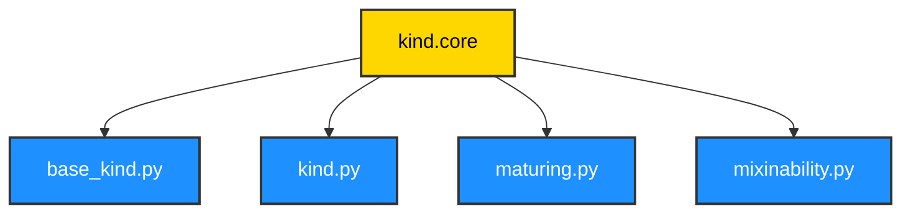
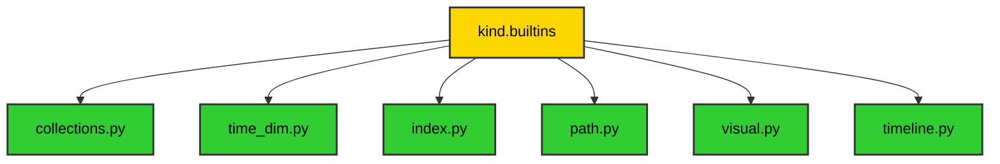

# 1.3 Layered Architecture: Modularity and Extensibility

The `Kind` framework is designed with a **layered architecture**, a fundamental principle that separates concerns into distinct, hierarchical layers. This approach ensures a lean and stable core while allowing for flexible and modular extension of functionalities. The primary distinction is between the `kind.core` package, which houses the essential building blocks, and the `kind.builtins` package, which provides optional, high-level extensions.

## Core Layer (`kind.core`)

This layer represents the foundational elements of the `Kind` framework. It contains the absolute minimum necessary for a `Kind` object to exist and to participate in graph structures. Key characteristics include:

-   **Minimalism**: Focuses solely on the fundamental definition of a `Kind`, its unique identification (interning), and the basic mechanisms for establishing and managing relationships (parents, children).
-   **Stability**: Designed to be highly stable and rarely change, providing a robust base for all other functionalities.
-   **Independence**: Ideally, this layer has minimal dependencies on higher-level components, ensuring its integrity and reusability.


## Builtin Extensions Layer (`kind.builtins`)

This layer comprises a collection of modular extensions that provide specialized functionalities to `Kind` objects. These extensions are designed to be plug-and-play, allowing developers to include only the features relevant to their specific application without bloating the core.

-   **Modularity**: Each module within `kind.builtins` addresses a specific domain (e.g., date/time, collections, visualization).
-   **Extensibility**: New functionalities can be easily added by creating new modules in this layer, adhering to the framework's extension protocols.
-   **Controlled Dependencies**: While `kind.builtins` modules depend on `kind.core`, the `kind.core` generally remains independent of `kind.builtins`, maintaining the hierarchical integrity.


## Inter-Layer Communication

The `kind.core` package, particularly `kind.py`, integrates with selected `kind.builtins` modules to enhance its fundamental capabilities. For instance, `KindIndex` from `kind.builtins.index` is used within the `Kind` class to manage per-instance indexing. This controlled dependency allows the core to leverage specialized, well-encapsulated functionalities without compromising its lean design.

### Code Example: Core Leveraging Builtins

```python
# From kind/core/kind.py
from ..builtins.collections import OrderedKindSet
from ..builtins.index import KindIndex

class Kind(BaseKind):
    def __new__(cls, name: str, origin: Optional[Any] = None):
        obj = super().__new__(cls, name, origin)
        if not hasattr(obj, 'index'):
            obj.index = KindIndex(obj) # Core uses a builtin for indexing
            obj.metadata = DefDict()
            obj.context = DefDict()
        # ... rest of __new__
```

### Industry Applications

**High-Tech: Microservices Architecture**
```python
from kind import k

# Core services
k.AuthService.provides(k.UserAuthentication)
k.DataStorageService.provides(k.DataPersistence)

# Specialized services (builtin)
k.PaymentProcessingService.uses(k.AuthService)
k.RecommendationEngine.uses(k.DataStorageService)

print(f"Payment service uses: {[c.name for c in k.PaymentProcessingService.children]}")
```
<details>
<summary>Outcome</summary>

```text
Payment service uses: []
```
</details>

**Low-Tech: Modular Furniture Design**
```python
from kind import k

# Core components
k.BasicFrame.connects_with(k.StandardConnector)

# Add-on modules (builtin)
k.ShelfModule.attaches_to(k.BasicFrame)
k.DrawerModule.attaches_to(k.BasicFrame)

print(f"Basic frame connections: {[c.name for c in k.BasicFrame.children]}")
```
<details>
<summary>Outcome</summary>

```text
Basic frame connections: []
```
</details>

## Conclusion

The layered architecture of the `Kind` framework is a testament to its robust and scalable design. By clearly separating core functionalities from modular extensions, it achieves a balance between minimalism and extensibility, making it adaptable to a wide array of complex symbolic data manipulation tasks while maintaining a clean and maintainable codebase.
