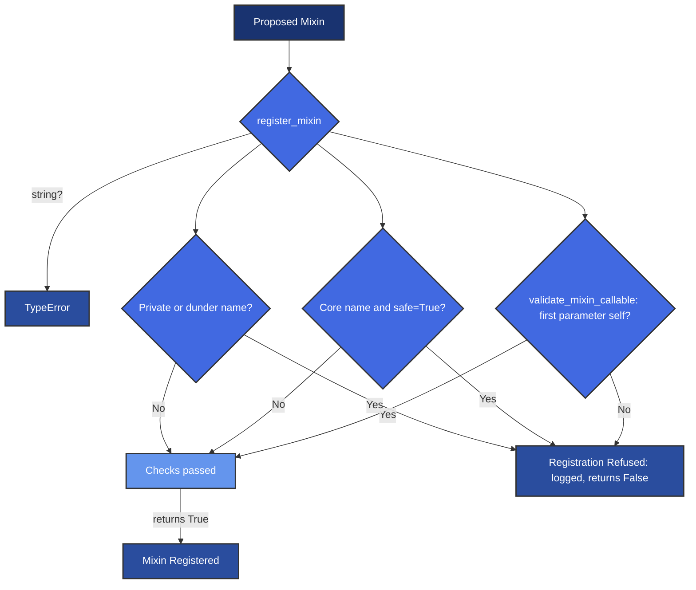
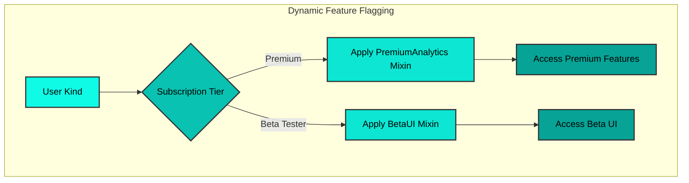
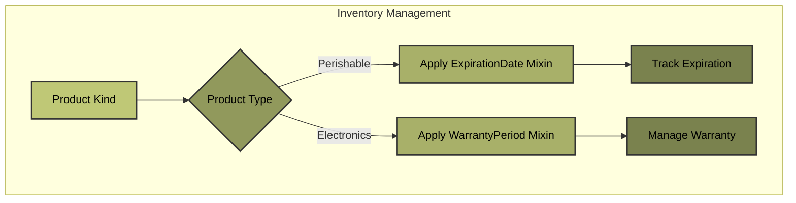

# Mixinability: Dynamic Extensibility of Kind Instances

The `Kind` framework introduces a sophisticated mixinability mechanism, enabling the dynamic extension of `Kind` instances at runtime. This capability is crucial for building highly adaptable and modular systems, allowing behaviors and attributes to be attached to kinds based on contextual needs without altering their core definition. This approach aligns with principles of open/closed principle and composition over inheritance, fostering a flexible and maintainable codebase.

## Dynamic Extension and Validation

At its core, mixinability in `Kind` is managed through the `register_mixin(value, name=None, target_class=None, safe=True, expand=True)` function, which attaches new functionalities (functions, classes and modules expanded into their public members) to `BaseKind` by default, so every `Kind` sees them. Mixins live on the class, so they apply in every `KindSpace`. The time dimension is an opt-in example: `import kind.time` registers `as_date`, `hour`, `time_head` and the other time properties on every Kind; without it a Kind has none. A mixin is trusted code: registering one is the same as editing the class. What `register_mixin` guarantees is that a mixin cannot silently replace the core API.

### Validation Process
The checks are:
- **No evaluation of strings**: a string `value` raises `TypeError`; pass the function, class or module object itself.
- **Reserved names**: private and dunder names (`_x`, `__x__`) are always refused.
- **Core names**: a name the target class (or a subclass) already defines is refused unless `safe=False`; replacing a previously registered mixin is allowed.
- **Signature Conformance**: `kind.core.mixin_validator.validate_mixin_callable` checks that a mixin function takes `self` as its first parameter. It inspects the signature only; it does not judge what the code does and does not detect unsafe code.

A refused registration logs the reason and returns `False`.


## Freezing Mechanism

To ensure stability and prevent unintended modifications in production environments, `kind.core.mixinability.lock_mixins()` locks the mixin registry for the whole process: further registrations are refused (`mixins_locked()` reports the state). This is particularly valuable in long-running applications or systems where dynamic changes could lead to unpredictable states.

Freezing a single Kind is a separate, per-instance operation: `kind.freeze()` (or `kind.immute()`, which elevates, slims and then freezes) makes that Kind raise `FrozenKindError` on any attribute, edge or relation change; `kind.frozen` reports it. To attach a mixin to one Kind only, use `apply_mixin_to_instance(kind, mixin)`.

## Examples

**High-Tech: Dynamic Feature Flagging in SaaS Platforms**
```python
from kind import Kind, k
from kind.core.mixinability import lock_mixins, register_mixin

class FeatureMixins:
    def enable_premium_analytics(self):
        return f"Premium analytics enabled for {self.name}"

    def enable_beta_ui(self):
        return f"Beta UI enabled for {self.name}"

register_mixin(FeatureMixins.enable_premium_analytics, "premium_analytics")
register_mixin(FeatureMixins.enable_beta_ui, "beta_ui")

user_premium = k.user_premium_tier
user_beta = k.user_beta_tester

print(user_premium.premium_analytics())
print(user_beta.beta_ui())

lock_mixins()
if not register_mixin(lambda self: "New feature", "new_feature"):
    print("Failed to register new_feature: the mixin registry is locked.")
```


### Low-Tech Industry: Inventory Management System

In an inventory management system, different types of products might have unique behaviors (e.g., perishable items needing expiration date tracking, electronics needing warranty information). Mixinability allows these behaviors to be attached dynamically.

```python
from kind import k
from kind.core.mixinability import register_mixin

class ProductMixins:
    def get_expiration_date(self):
        # In a real system, this would fetch from a database or attribute
        return "2025-12-31"

    def get_warranty_period(self):
        return "1 year"

# Create product kinds
apple = k.Apple
laptop = k.Laptop

# Apply mixins based on product type
register_mixin(ProductMixins.get_expiration_date, "expiration_date")
register_mixin(ProductMixins.get_warranty_period, "warranty_period")

# Access product-specific behaviors
print(f"Apple expiration: {apple.expiration_date()}")
# Output: Apple expiration: 2025-12-31

print(f"Laptop warranty: {laptop.warranty_period()}")
# Output: Laptop warranty: 1 year
```


## Conclusion

Mixinability in the `Kind` framework provides a powerful and guarded mechanism for dynamic extensibility. By combining runtime flexibility with name and signature checks, a process-wide registry lock and per-instance freezing, it enables developers to build highly modular, adaptable, and robust systems across various domains, from complex high-tech applications to traditional enterprise solutions.

For a visual representation of the mixin application flow, refer to the [Mixinability Flow Diagram](mixinability_flow.mmd).

---
