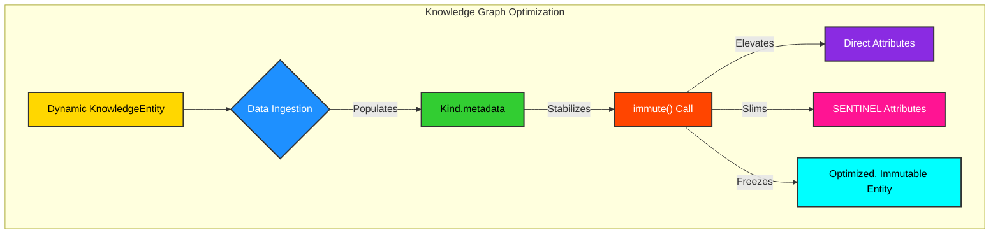
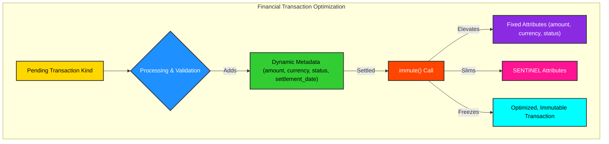

# Memory-Aware Maturing: Optimizing Kind Lifecycle

The `Kind` framework incorporates a sophisticated "maturing" process, orchestrated by the `immute()` method. This process is designed to optimize the memory footprint and performance of `Kind` instances by transitioning them from a flexible, dynamically extensible state to a more rigid, optimized, and immutable form. This is particularly beneficial for long-lived kinds or those that have reached a stable state in their lifecycle, where further dynamic modifications are not anticipated.

## The Maturing Process: Elevate, Slim, and Freeze

The `immute()` method orchestrates three distinct phases:

1.  **Elevate Metadata (`elevate()`)** This phase promotes key-value pairs stored in the `Kind`'s `metadata` `DefDict` (a `defaultdict` of `defaultdict`s); directly into instance attributes or methods. This transformation reduces the overhead associated with dictionary lookups and allows for faster, direct attribute access. Various merge strategies (e.g., `overwrite`, `patch`, `smooth`) can be applied to handle potential conflicts with existing attributes. A key naming a Kind method or read-only property is not elevated: it stays in `metadata` with a warning.

    ```mermaid
    graph TD
        A[Kind.metadata] --> B{Elevate};
        B -- "Promotes" --> C[Dynamic Key-Value Pairs];
        C --> D[Direct Instance Attributes/Methods];
        D -- "Faster Access" --> E[Optimized Performance];

    style A fill:#FFD700,stroke:#333,stroke-width:2px,color:#000000;
    style B fill:#1E90FF,stroke:#333,stroke-width:2px,color:#FFFFFF;
    style C fill:#32CD32,stroke:#333,stroke-width:2px,color:#000000;
    style D fill:#FF4500,stroke:#333,stroke-width:2px,color:#FFFFFF;
    style E fill:#8A2BE2,stroke:#333,stroke-width:2px,color:#FFFFFF;
    ```
    
2.  **Slim Down (`slim()`):** Following elevation, the `slim()` method drops elevated attributes whose value is `SENTINEL` (a placeholder for a part that holds no value), unless they are protected; `immute()` protects the keys it just elevated. It does not delete slots and does not call `gc.collect()`; Python's garbage collector reclaims what is no longer referenced.

    ```mermaid
    graph TD
        A[Kind Instance] --> B{Slim#40;#41;};
        B -- "Removes" --> C[Elevated Attributes holding SENTINEL];
        C --> D[Unless protected];
        D -- "Reduces" --> E[Memory Footprint];

      style A fill:#FFD700,stroke:#333,stroke-width:2px,color:#000000;
      style B fill:#1E90FF,stroke:#333,stroke-width:2px,color:#FFFFFF;
      style C fill:#32CD32,stroke:#333,stroke-width:2px,color:#000000;
      style D fill:#FF4500,stroke:#333,stroke-width:2px,color:#FFFFFF;
      style E fill:#8A2BE2,stroke:#333,stroke-width:2px,color:#FFFFFF;
    ```
    
3.  **Freeze (`freeze()`):** The final step in the maturing process is to freeze *that* `Kind` instance; other Kinds stay mutable. A frozen Kind raises `FrozenKindError` on any attribute, edge or relation change, and `kind.frozen` reports the state. Freezing ensures the immutability and predictability of a matured Kind, safeguarding against unintended side effects. (Locking the mixin registry for the whole process is a separate call: `lock_mixins()`.)

    ```mermaid
    graph TD
        A[Kind Instance] --> B{Freeze#40;#41;};
        B -- "Prevents" --> C[Further Changes to this Kind];
        C --> D[Attribute, Edge and Relation Changes raise FrozenKindError];
        D --> E[Ensures] --> F[Immutability & Predictability];

      style A fill:#FFD700,stroke:#333,stroke-width:2px,color:#000000;
      style B fill:#1E90FF,stroke:#333,stroke-width:2px,color:#FFFFFF;
      style C fill:#32CD32,stroke:#333,stroke-width:2px,color:#000000;
      style D fill:#FF4500,stroke:#333,stroke-width:2px,color:#FFFFFF;
      style E fill:#8A2BE2,stroke:#333,stroke-width:2px,color:#FFFFFF;
      style F fill:#FF1493,stroke:#333,stroke-width:2px,color:#FFFFFF;
    ```
    
## Examples

### High-Tech Industry: Optimizing Large-Scale Knowledge Graphs

```python
from kind import Kind, k
from kind.core.kind import FrozenKindError
from kind.core.mixinability import register_mixin

entity = k.QuantumPhysics
entity.metadata.update({
    "field": "Physics",
    "subfield": "Quantum Mechanics",
    "established": 1900,
    "key_figures": ["Planck", "Einstein", "Bohr"]
})

def get_summary(self):
    return f"Summary of {self.name}: Field={self.field}, Established={self.established}"

register_mixin(get_summary, name="get_summary", target_class=Kind)

entity.immute()  # elevate -> slim -> freeze, of this Kind only

print(f"Field as attribute: {entity.field}")
print(f"Summary as attribute: {entity.get_summary()}")
print(f"Frozen: {entity.frozen}, another Kind frozen: {k.Chemistry.frozen}")
try:
    entity.field = "Chemistry"
except FrozenKindError as error:
    print(f"Refused: {type(error).__name__}")
```
<details>
<summary>Outcome</summary>

```text
Field as attribute: Physics
Summary as attribute: Summary of QuantumPhysics: Field=Physics, Established=1900
Frozen: True, another Kind frozen: False
Refused: FrozenKindError
```
</details>



### Low-Tech Industry: Financial Transaction Processing

```python
from kind import k

transaction = k.TXN_001
transaction.metadata.update(amount=100.50, currency="USD", status="pending",
                            details={"merchant": "Coffee Shop"})

transaction.metadata["status"] = "settled"
transaction.metadata["settlement_date"] = "2025-07-04"

transaction.immute()

print(f"Transaction amount: {transaction.amount} {transaction.currency}")
print(f"Transaction status: {transaction.status}")
print(f"Settlement date: {transaction.settlement_date}")
```
<details>
<summary>Outcome</summary>

```text
Transaction amount: 100.5 USD
Transaction status: settled
Settlement date: 2025-07-04
```
</details>


## Conclusion

Memory-aware maturing in the `Kind` framework provides a powerful mechanism for optimizing the lifecycle of `Kind` instances. By systematically elevating dynamic metadata, slimming down placeholder attributes, and freezing the matured Kind, it enables developers to achieve significant memory savings and performance improvements, particularly in data-intensive applications. This feature underscores `Kind`'s commitment to both flexibility and efficiency.

For a visual representation of the maturing process, refer to the [Maturing Process Diagram](maturing_process.mmd).

---
