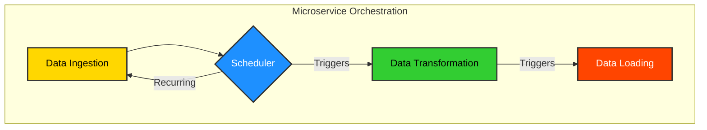
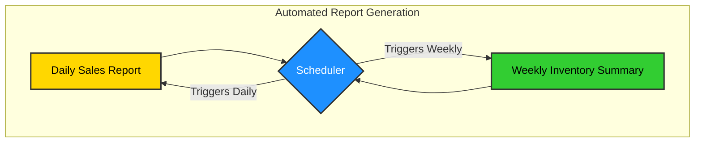

# Scheduling: Event-Driven Automation with Kind

The `Kind` framework integrates a robust scheduling mechanism, enabling the deferred and automated execution of tasks. This feature is critical for building event-driven architectures, automating workflows, and managing background processes within applications. The scheduler is designed for flexibility, supporting various scheduling paradigms from precise time dimension triggers to recurring cron-like expressions.

## Core Components: ScheduledJob and Scheduler

The scheduling system is built around two primary components:

1.  **`ScheduledJob`**: This class encapsulates a single task to be executed. It holds references to the callable function (`func`), its arguments (`args`, `kwargs`), and crucially, the `schedule` on which it should run. Its signature is `ScheduledJob(func, args=(), kwargs=None, schedule="* * * * *", id=None, now=None)` (`now` is the base time for the first cron `next_run`). The `schedule` can be a `datetime.datetime`, `datetime.date` or `datetime.time` (or an ISO 8601 string) for one-off tasks, a `cron` string for recurring jobs, or even a `Kind` instance whose name represents an ISO 8601 datetime string.

    ```mermaid
    graph TD
            A[Callable Function] --> B[ScheduledJob];
            C[Arguments #40;args, kwargs#41;] --> B;
            D[Schedule #40;datetime, date, time, cron string, Kind#41;] --> B;
            B -- "Calculates" --> E[Next Run Time];
    
        style A fill:#FFD700,stroke:#333,stroke-width:2px,color:#000000;
        style B fill:#1E90FF,stroke:#333,stroke-width:2px,color:#FFFFFF;
        style C fill:#32CD32,stroke:#333,stroke-width:2px,color:#000000;
        style D fill:#FF4500,stroke:#333,stroke-width:2px,color:#FFFFFF;
        style E fill:#8A2BE2,stroke:#333,stroke-width:2px,color:#FFFFFF;
    ```
2.  **`Scheduler`**: This class manages a collection of `ScheduledJob` instances: `Scheduler(schedule_file=None, allowed_modules=(), now=datetime.datetime.now)`. `await scheduler.start(task_group)` runs its loop as a task in an `anyio` task group, executing jobs when their `next_run` time arrives (sync functions in a worker thread, async ones awaited); `await scheduler.run_due_jobs()` is one deterministic step of that loop, and the clock `now` is injectable. The `Scheduler` uses a min-heap (`_schedule`) to efficiently retrieve the next job to be executed, ensuring timely processing. It also supports persistence, allowing the schedule to be saved to and loaded from a file, thus surviving application restarts. A schedule file names functions by dotted path, so loading one runs code: only functions from `allowed_modules` are resolved (CLI: `kind-scheduler -f FILE -m MODULE add|list|remove|run`).

    ```mermaid
    graph TD
        A[Scheduler] --> B{add_job#40;#41;};
        B -- "Adds Job to" --> C[Min-Heap];;
        C -- "Monitors" --> D[Loop Task #40;anyio#41;];
        D -- "Executes Job" --> E[Callable Function];
        E -- "If Recurring" --> F[Reschedules Job];

      style A fill:#FFD700,stroke:#333,stroke-width:2px,color:#000000;
      style B fill:#1E90FF,stroke:#333,stroke-width:2px,color:#FFFFFF;
      style C fill:#32CD32,stroke:#333,stroke-width:2px,color:#000000;
      style D fill:#FF4500,stroke:#333,stroke-width:2px,color:#FFFFFF;
      style E fill:#8A2BE2,stroke:#333,stroke-width:2px,color:#FFFFFF;
      style F fill:#FF1493,stroke:#333,stroke-width:2px,color:#FFFFFF;
    ```

## Illustrative Examples

### Microservice Orchestration
```python
import datetime

import anyio

from kind.core.schedule import ScheduledJob, Scheduler

clock = {"now": datetime.datetime(2026, 10, 2, 9, 0, 0)}  # an injectable clock makes runs deterministic
now = lambda: clock["now"]

def data_ingestion(): print(f"[{now()}] Data Ingestion.")
def data_transformation(): print(f"[{now()}] Data Transformation.")
def data_loading(): print(f"[{now()}] Data Loading.")

scheduler = Scheduler(now=now)
scheduler.add_job(ScheduledJob(data_ingestion, schedule="* * * * *", now=now()))
scheduler.add_job(ScheduledJob(data_transformation, schedule=now() + datetime.timedelta(seconds=10)))
scheduler.add_job(ScheduledJob(data_loading, schedule=now() + datetime.timedelta(seconds=20)))

async def main():
    for _ in range(4):  # four steps, 30 seconds apart; start(task_group) runs this loop for real
        clock["now"] += datetime.timedelta(seconds=30)
        await scheduler.run_due_jobs()

anyio.run(main)
```
<details>
<summary>Outcome</summary>

```text
[2026-10-02 09:00:30] Data Transformation.
[2026-10-02 09:00:30] Data Loading.
[2026-10-02 09:01:00] Data Ingestion.
[2026-10-02 09:02:00] Data Ingestion.
```
</details>



Automated Report Generation

For businesses, automated report generation is a common requirement. The `Kind` scheduler can reliably handle tasks like generating daily sales reports, weekly inventory summaries, or monthly financial statements.

```python
import datetime

import anyio

from kind.core.schedule import ScheduledJob, Scheduler


def generate_daily_sales_report():
    print("Generating daily sales report...")


def generate_weekly_inventory_summary():
    print("Generating weekly inventory summary...")


async def main():
    scheduler = Scheduler()
    # Daily sales report at 23:00, weekly inventory summary on Mondays at 09:00
    scheduler.add_job(ScheduledJob(generate_daily_sales_report, schedule="0 23 * * *"))
    scheduler.add_job(ScheduledJob(generate_weekly_inventory_summary, schedule="0 9 * * MON"))
    # A one-off job two seconds from now, to see the loop at work
    soon = datetime.datetime.now() + datetime.timedelta(seconds=2)
    scheduler.add_job(ScheduledJob(generate_daily_sales_report, schedule=soon))

    print("Starting report generation scheduler...")
    async with anyio.create_task_group() as task_group:
        await scheduler.start(task_group)
        await anyio.sleep(3)  # let it run for a bit
        await scheduler.stop()
    print(f"Scheduler stopped. Jobs left: {len(scheduler.job_map)}")

anyio.run(main)
```
<details>
<summary>Outcome</summary>

```text
Starting report generation scheduler...
Generating daily sales report...
Scheduler stopped. Jobs left: 2
```
</details>


## Conclusion

The `Kind` framework's scheduling capabilities provide a powerful and flexible foundation for automating tasks and orchestrating complex processes. By offering diverse scheduling options and robust job management, it empowers developers to build highly responsive and efficient systems, from sophisticated microservice deployments to routine business operations. The persistence feature further enhances its utility by ensuring that scheduled tasks are not lost across application lifecycles.

For a visual representation of the scheduling process, refer to the [Scheduling Flow Diagram](scheduling_flow.mmd).

---
