# API Highlights: Core Functionality of the Kind Framework

The `Kind` framework provides a concise yet powerful API for manipulating symbolic data. This section details the key methods and properties that form the backbone of its functionality, offering insights into their design principles and practical applications.

## `Kind(name: str)`: Globally Interned, Idempotent Constructor

The `Kind` constructor serves as the fundamental entry point for creating symbolic entities within the framework. Its design adheres to the **Flyweight pattern**, ensuring that for any given `name` string, only a single `Kind` object instance exists in memory. One pool serves all classes, and it is weak: a Kind keeps its identity only while something references it. This global interning mechanism guarantees object identity and optimizes memory utilization, particularly in scenarios involving a large number of recurring symbolic representations. The constructor is idempotent, meaning repeated calls with the same `name` will consistently return the identical `Kind` instance, thereby maintaining referential integrity across the system.

### Purpose and Usage
This method is used to create or retrieve a unique `Kind` instance based on its string `name`. It's the primary way to introduce new symbolic entities into the graph.

### Code Example
```python
from kind import Kind, k

s1 = k.my_unique_kind
s2 = k.my_unique_kind
s3 = k.another_kind

print(f"s1 is s2: {s1 is s2}")
print(f"s1 is s3: {s1 is s3}")

# Repeated construction is a pool lookup (an average O(1) dict access)
import time

start_time = time.perf_counter_ns()
for _ in range(100000):
    Kind('test_kind')
end_time = time.perf_counter_ns()
print(f"Time for 100,000 Kind instantiations: {(end_time - start_time) / 1_000_000:.2f} ms")
```
<details>
<summary>Outcome</summary>

```text
s1 is s2: True
s1 is s3: False
Time for 100,000 Kind instantiations: 300.44 ms
```

The timing is one measured run; it varies by machine.
</details>

### Diagram
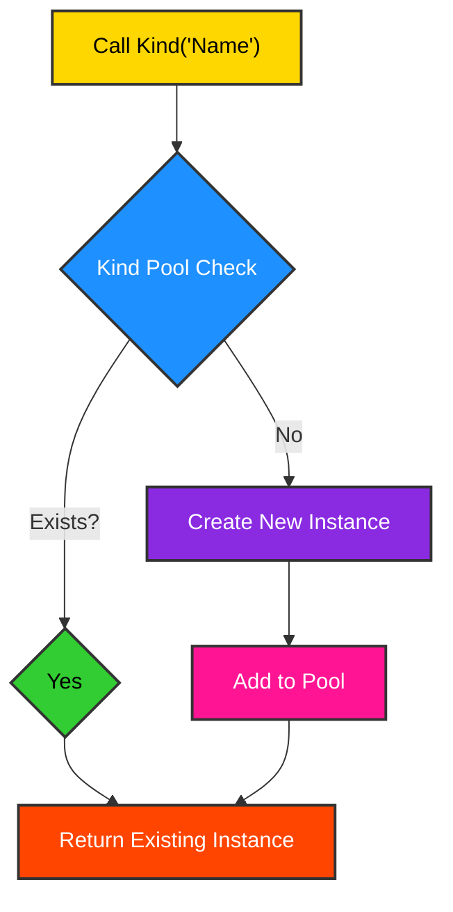
## `Kind.next()`: Creates and Chains Auto-Numbered Kinds

The `Kind.next()` class method provides a convenient mechanism for generating a sequence of automatically numbered `Kind` instances. This functionality is particularly useful for creating transient or placeholder kinds, or for scenarios where unique identifiers are required without the need for explicit naming. The method also implicitly establishes a linked-list-like chain between consecutively generated kinds, facilitating sequential traversal.

### Purpose and Usage
To generate a new `Kind` with an auto-incrementing name (e.g., `kind_0`, `kind_1`, `kind_2`, ...). It's ideal for quick prototyping or when the specific name of a kind is not semantically important.

### Code Example
```python
from kind import Kind

# Generate auto-numbered kinds
kind0 = Kind.next()
kind1 = Kind.next()
kind2 = Kind.next()

print(f"Generated kinds: {kind0.name}, {kind1.name}, {kind2.name}")
print(f"kind0 next is kind1: {kind0._next is kind1}")
print(f"kind1 prev is kind0: {kind1._prev is kind0}")
```
<details>
<summary>Outcome</summary>

```text
Generated kinds: kind_0, kind_1, kind_2
kind0 next is kind1: True
kind1 prev is kind0: True
```
</details>

### Diagram
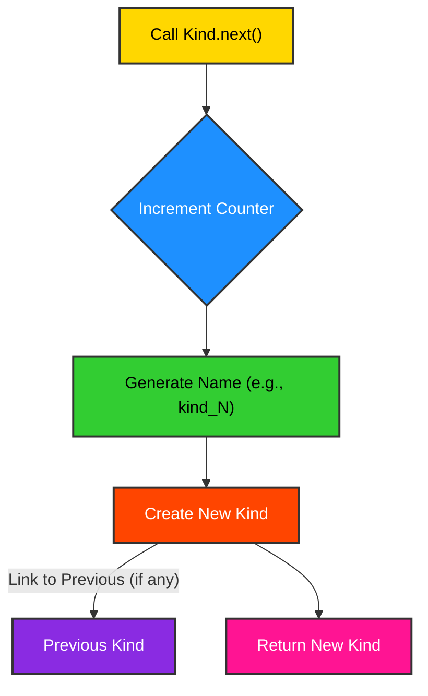
## `kind.append(child)` and Dynamic Relations: Link Construction

The `Kind` framework provides intuitive methods for establishing relationships between symbolic entities, forming the edges of the underlying directed acyclic graph (DAG). `append(child)` creates a direct parent-child relationship. For more semantically rich and arbitrary connections, the framework now supports dynamic relation creation via attribute access, allowing for a highly expressive and readable way to define the nature of the relationship.

### Purpose and Usage
These methods are used to build the graph structure by defining directed relationships between `Kind` instances. `append` is for simple hierarchical relationships. Dynamic relations allow for custom relationship types using a natural, dot-notation syntax, where the attribute name becomes the 'how' of the relation: `a.depends_on(b)` is `a.relate(b, how='depends_on')` (any public name; private names such as `_x` raise `AttributeError`), and `a.unrelate(b, how=None)` removes one or all relations to `b`. A relation holds a strong reference, so a related Kind stays alive.

### Code Example
```python
from kind import k

parent = k.Parent
child1 = k.Child1
child2 = k.Child2
related_entity = k.RelatedEntity

parent.append(child1)
parent.append(child2)
parent.depends_on(related_entity) # New dynamic relation syntax

print(f"Parent children: {[c.name for c in parent.children]}")
print(f"Child1 parents: {[p.name for p in child1.parents]}")
```
<details>
<summary>Outcome</summary>

```text
Parent children: ['Child1', 'Child2']
Child1 parents: ['Parent']
```
</details>

### Diagram
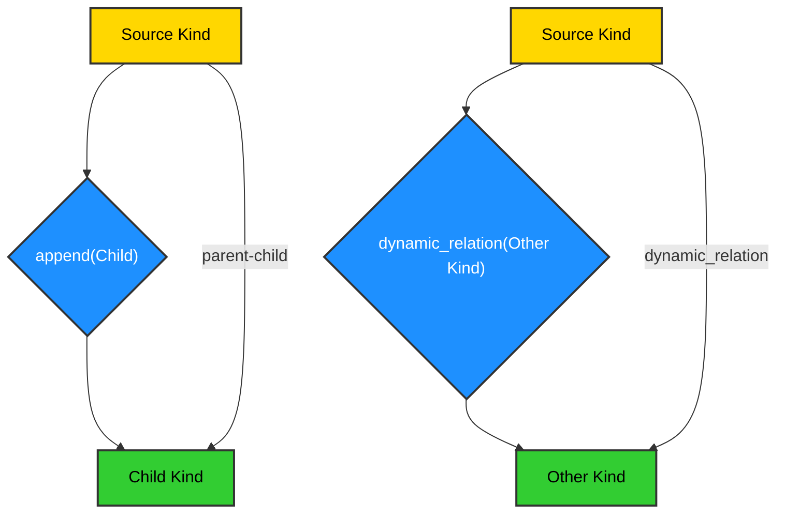
## `kind.tree()` / `kind.graph()` / `GraphTraversal`: Traversal

The `Kind` framework provides methods for traversing the underlying graph structure. `tree()` returns the Kind and its descendants (children only), depth first; `graph()` also follows parents and relations. Both return lists, built iteratively. For breadth-first order, use `GraphTraversal(root, traverse_mode='bfs', family_mode='children_only').traverse()`; `family_mode` is `'children_first'` (default), `'parents_first'` or `'children_only'`. There is no `que()` method.

### Purpose and Usage
These methods are used to navigate the graph of `Kind` instances. `tree()` is suitable for hierarchical views, a BFS `GraphTraversal` for level-by-level processing.

### Code Example
```python
from kind import GraphTraversal, Kind

# Build a sample graph
root = Kind('Root')
level1_a = Kind('Level1_A')
level1_b = Kind('Level1_B')
level2_a1 = Kind('Level2_A1')
level2_a2 = Kind('Level2_A2')

root.append(level1_a)
root.append(level1_b)
level1_a.append(level2_a1)
level1_a.append(level2_a2)

# Tree traversal (Depth-First, children only)
print("Tree Traversal:")
for kind in root.tree():
    print(kind.name)

# Breadth-First traversal
print("\nBreadth-First Traversal:")
for kind in GraphTraversal(root, traverse_mode='bfs', family_mode='children_only').traverse():
    print(kind.name)
```
<details>
<summary>Outcome</summary>

```text
Tree Traversal:
Root
Level1_A
Level2_A1
Level2_A2
Level1_B

Breadth-First Traversal:
Root
Level1_A
Level1_B
Level2_A1
Level2_A2
```
</details>

### Diagram
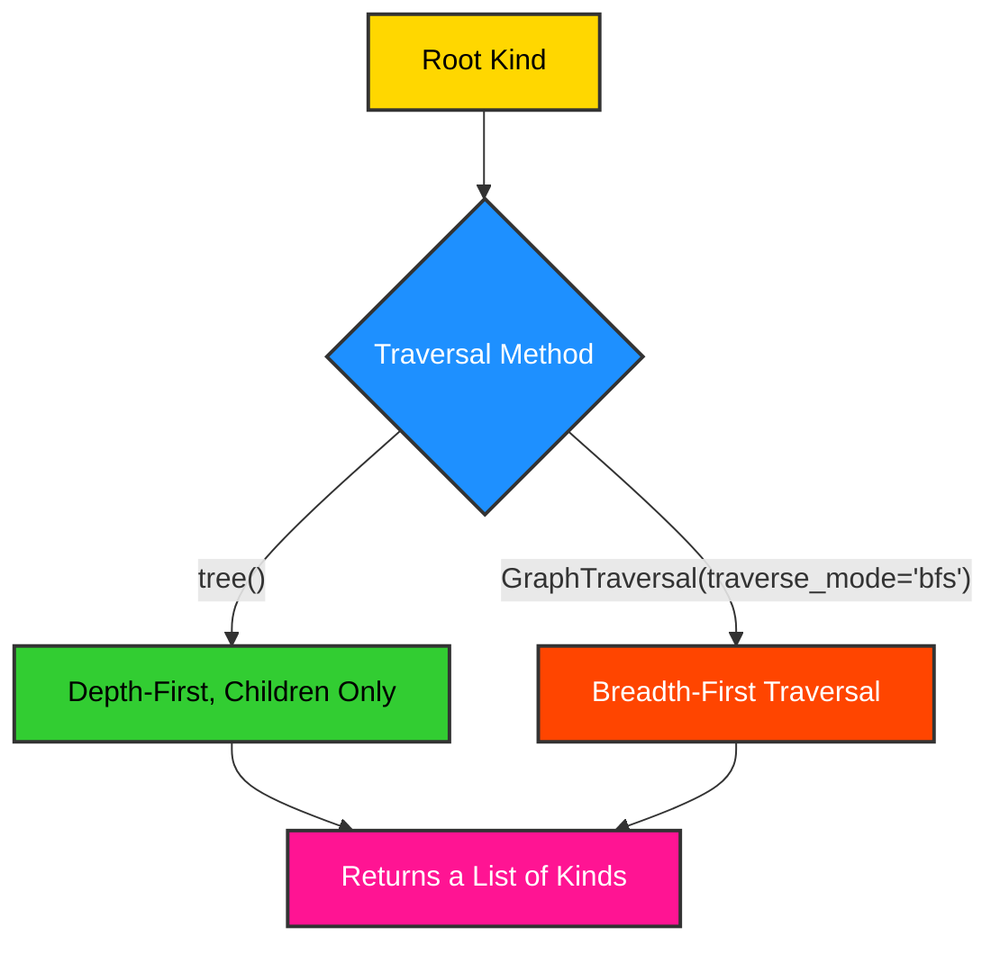
## `kind.patch(other)`: Structural Merge of Another Kind's Links

The `patch()` method provides a powerful mechanism for merging the structural and relational aspects of two `Kind` instances. Unlike a simple overwrite, `patch()` merges the other Kind's direct links (it does not recurse), combining the origin (if unset), children, parents, and related entities of the `other` kind into the current kind. This operation is crucial for scenarios involving data synchronization, version control, or the aggregation of information from disparate sources within a graph.

### Purpose and Usage
To combine the graph structure of another `Kind` into the current `Kind` without losing existing relationships. It's particularly useful for updating a `Kind` with new information or merging branches in a graph.

### Code Example
```python
from kind import Kind

# Create base kind
base = Kind('Base')
base.append(Kind('CommonChild'))
base.append(Kind('BaseSpecificChild'))

# Create another kind with overlapping and new children
update = Kind('Update')
update.append(Kind('CommonChild')) # Overlapping child
update.append(Kind('UpdateSpecificChild'))

print("Before patch:")
print(f"Base children: {[c.name for c in base.children]}")

# Patch the base kind with the update kind
base.patch(update)

print("\nAfter patch:")
print(f"Base children: {[c.name for c in base.children]}")
```
<details>
<summary>Outcome</summary>

```text
Before patch:
Base children: ['CommonChild', 'BaseSpecificChild']

After patch:
Base children: ['CommonChild', 'BaseSpecificChild', 'UpdateSpecificChild']
```
</details>

### Diagram
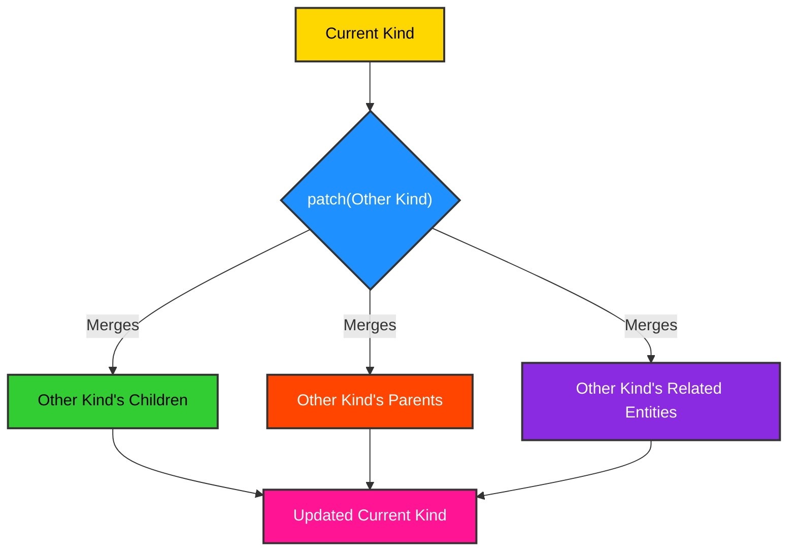
## `kind.to_mmd()`: Outputs the Graph in Mermaid Diagram Syntax

The `to_mmd()` method (no arguments) provides a direct utility for visualizing everything reachable from a `Kind` through children and relations in the widely adopted Mermaid diagram syntax. The output is `graph LR`, then the sorted node declarations with their shapes (`[x]` default rectangle, `(x)` round, `[[x]]` subroutine, `{x}` rhombus, ... chosen by `kind.node_shape`), then the edges: `A --> B` for children and `A -- how --> B` for relations. Its inverse, `from_mmd`, lives in `kind.builtin.visual` and is a mixin on every Kind. This capability is invaluable for documentation, debugging, and communicating complex graph structures in a human-readable and easily renderable format. It transforms the internal graph representation into a textual description that can be rendered by Mermaid-compatible tools.

### Purpose and Usage
To generate a Mermaid graph definition string representing the `Kind`'s graph structure. This string can then be embedded in Markdown documents or used with Mermaid rendering tools.

### Code Example
```python
from kind import Kind

# Build a sample graph
root = Kind('Project')
task1 = Kind('Task1')
task2 = Kind('Task2')
subtask1_1 = Kind('Subtask1_1')

root.append(task1)
root.append(task2)
task1.append(subtask1_1)

# Generate Mermaid syntax
mermaid_syntax = root.to_mmd()
print(mermaid_syntax)

```
<details>
<summary>Outcome</summary>

```text
graph LR
Project[Project]
Subtask1_1[Subtask1_1]
Task1[Task1]
Task2[Task2]
    Project --> Task1
    Task1 --> Subtask1_1
    Project --> Task2
```
</details>


### Diagram
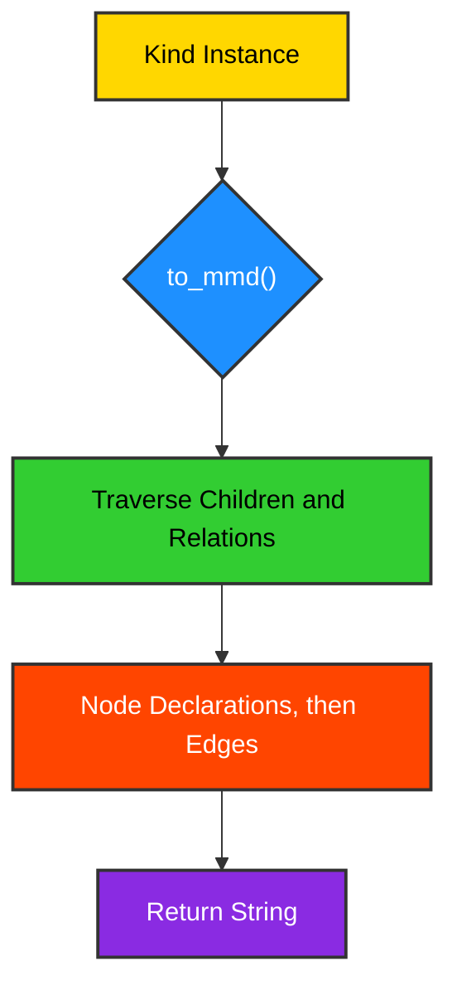
## `kind.to_ascii()`: Outputs ASCII Representation of Graphs

Complementing `to_mmd()`, the `to_ascii()` method offers an alternative, text-based visualization of the `Kind`'s graph structure. This is particularly useful for environments where graphical rendering is not available or desired, such as command-line interfaces, log files, or simple text-based reports. It provides a quick and accessible way to inspect the relationships between kinds.

### Purpose and Usage
To get a simple, text-based visual representation of the `Kind`'s graph: `to_ascii(traverse_mode='dfs'|'bfs', family_mode='children_first'|'parents_first')` lists children and parents indented by depth, followed by a `--- Relations ---` section when there are relations. Useful for quick debugging or console output; `Kind.from_ascii()` reads it back.

### Code Example
```python
from kind import Kind

# Build a sample graph
root = Kind('Root')
level1_a = Kind('Level1_A')
level1_b = Kind('Level1_B')
level2_a1 = Kind('Level2_A1')

root.append(level1_a)
root.append(level1_b)
level1_a.append(level2_a1)

# Generate ASCII art
ascii_art = root.to_ascii()
print(ascii_art)

```
<details>
<summary>Outcome</summary>

```text
- Root
  - Level1_A
    - Level2_A1
  - Level1_B
```
</details>

### Diagram
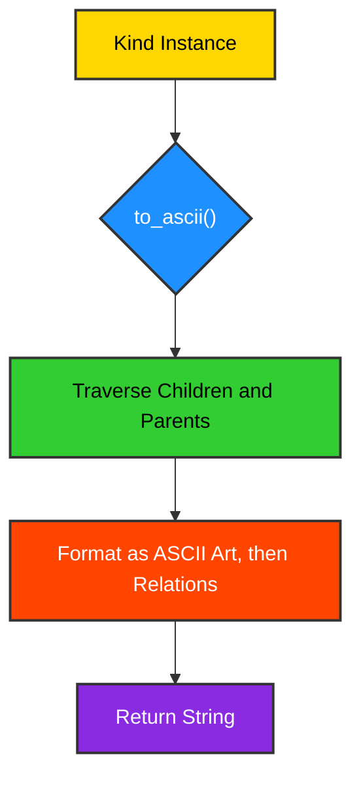
## `kind.delete()`: Removes Node and Its Inverse References

The `delete()` method provides a mechanism for safely removing a `Kind` instance from the graph. This operation is not merely a simple object deletion; it intelligently severs all incoming and outgoing relationships associated with the kind. Its children move up to its parents (re-parenting), its relations are removed in both directions, and it is removed from its parents' children, its children's parents, and the pool, ensuring graph consistency and preventing dangling references.

### Purpose and Usage
To completely remove a `Kind` and all its connections from the graph. This is a critical operation for managing the lifecycle of symbolic entities and maintaining graph integrity.

### Code Example
```python
from kind import Kind

# Build a sample graph
parent = Kind('Parent')
child = Kind('Child')
grandchild = Kind('Grandchild')

parent.append(child)
child.append(grandchild)

print(f"Before delete: Parent children: {[c.name for c in parent.children]}")
print(f"Before delete: Child parents: {[p.name for p in child.parents]}")

# Delete the child kind
child.delete()

print(f"After delete: Parent children: {[c.name for c in parent.children]}")
print(f"After delete: Child parents: {[p.name for p in child.parents]}")
print(f"After delete: Grandchild parents: {[p.name for p in grandchild.parents]}")  # re-parented
```
<details>
<summary>Outcome</summary>

```text
Before delete: Parent children: ['Child']
Before delete: Child parents: ['Parent']
After delete: Parent children: ['Grandchild']
After delete: Child parents: []
After delete: Grandchild parents: ['Parent']
```
</details>

### Diagram
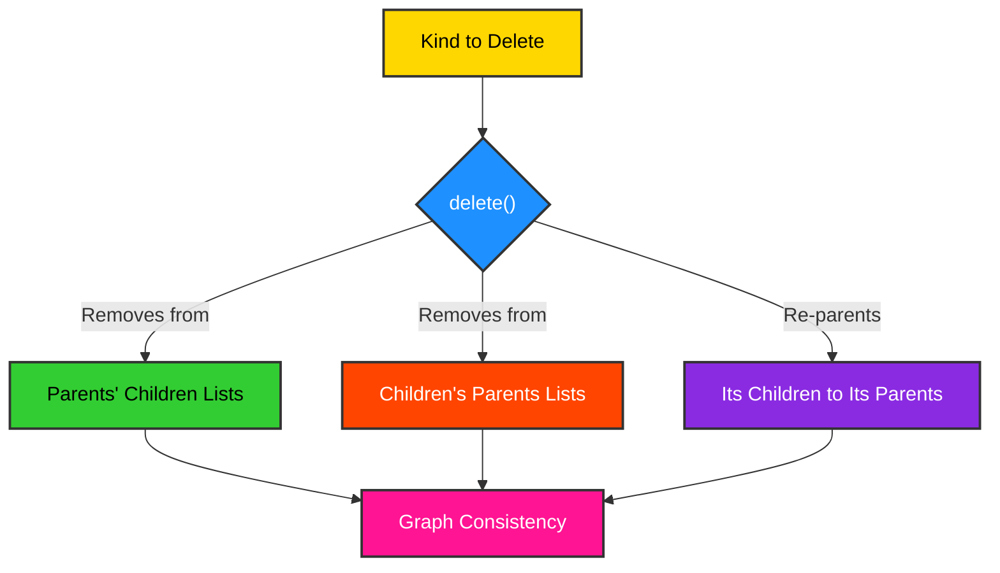
## `kind.elevate()`: Promotes Metadata to Instance Attributes/Methods

The `elevate()` method is a key component of the `Kind` framework's memory-aware maturing process. It facilitates the transformation of dynamic metadata, initially stored in the `Kind`'s `metadata` `DefDict`, into static, first-class instance attributes or methods. This promotion enhances performance by enabling direct attribute access, which is generally faster than dictionary lookups, and contributes to a more predictable object structure. `elevate()` returns the keys it moved; a key naming a Kind method or read-only property is refused with a warning and stays in `metadata`.

### Purpose and Usage
To convert dynamic metadata associated with a `Kind` into direct attributes or methods of the `Kind` instance. This is part of optimizing the `Kind`'s memory footprint and access speed.

### Code Example
```python
from kind import Kind
from kind.core.mixinability import register_mixin

# Create a kind with metadata
s = Kind('MyKind')
s.metadata['version'] = '1.0'
s.metadata['status'] = 'active'
s.metadata['frozen'] = 'yes'  # names a read-only Kind property: refused (with a warning), stays in metadata

def custom_method(self):
    return f"This is {self.name} version {self.version} with status {self.status}."

register_mixin(custom_method, 'get_info')

print(f"Before elevate: Metadata: {dict(s.metadata)}")

# Elevate metadata
elevated = s.elevate()

print(f"Elevated keys: {sorted(elevated)}")
print(f"After elevate: Metadata: {dict(s.metadata)}")
print(f"After elevate: version attribute: {s.version}")
print(f"Elevated method call: {s.get_info()}")
```
<details>
<summary>Outcome</summary>

```text
Before elevate: Metadata: {'version': '1.0', 'status': 'active', 'frozen': 'yes'}
Elevated keys: ['status', 'version']
After elevate: Metadata: {'frozen': 'yes'}
After elevate: version attribute: 1.0
Elevated method call: This is MyKind version 1.0 with status active.
```
</details>

### Diagram
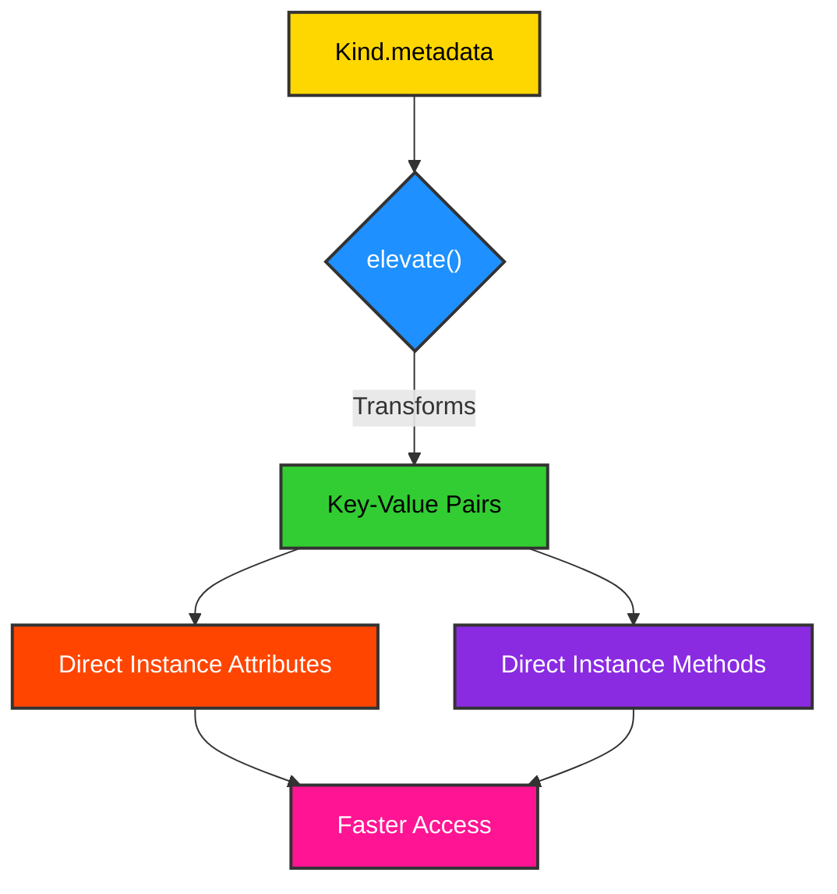
## `kind.slim()`: Drops Elevated Attributes That Hold No Value

The `slim()` method is another integral part of the `Kind` framework's memory optimization strategy. It drops the elevated attributes whose value is `SENTINEL` (a placeholder for a part that holds no value), unless they are listed in `protected_attributes`. It does not remove registered mixins (they live on the class), does not delete slots and does not call `gc.collect()`.

### Purpose and Usage
To clean up a `Kind` instance by removing placeholder attributes that are not explicitly protected. This is part of the memory optimization process, especially after `elevate()`; `immute()` protects the keys it just elevated.

### Code Example
```python
from kind import Kind
from kind.core.lazy_kind import SENTINEL

s = Kind('MySlimKind')
s.placeholder = SENTINEL   # an elevated attribute that holds no value yet
s.reserved = SENTINEL      # the same, but protected below
s.size = 42                # an elevated attribute with a value

print(f"Before slim: {sorted(s._elevated_attributes)}")

s.slim(protected_attributes={'reserved'})

print(f"After slim: {sorted(s._elevated_attributes)}")
```
<details>
<summary>Outcome</summary>

```text
Before slim: ['placeholder', 'reserved', 'size']
After slim: ['reserved', 'size']
```
</details>

### Diagram
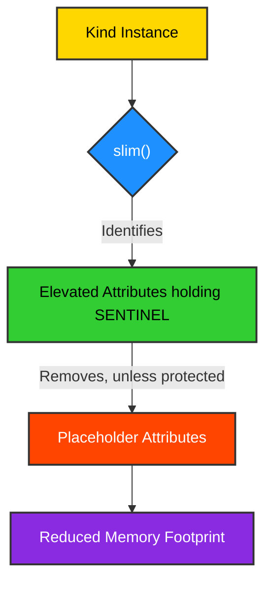
## `kind.immute()`: Orchestrates Maturing Process (Elevate, Slim, Freeze)

The `immute()` method serves as the orchestrator for the entire memory-aware maturing process. It encapsulates the sequential execution of `elevate()`, `slim()`, and `freeze()`, providing a single operation to transition a `Kind` instance into its optimized, immutable state. Freezing is per instance: other Kinds stay mutable, and a frozen Kind raises `FrozenKindError` on any attribute, edge or relation change. This method is designed to be called when a `Kind` has reached a stable point in its lifecycle, ensuring that its structure and behavior are finalized for performance and predictability.

### Purpose and Usage
To perform a complete memory optimization and finalization of a `Kind` instance. This method should be called when a `Kind`'s dynamic phase is complete and it needs to be optimized for long-term use.

### Code Example
```python
from kind import Kind
from kind.core.kind import FrozenKindError
from kind.core.mixinability import register_mixin

# Create a kind with initial dynamic state
s = Kind('FinalKind')
s.metadata['config_param'] = 'value_A'

def dynamic_behavior(self):
    return f"Dynamic behavior for {self.name}."

register_mixin(dynamic_behavior, name='dyn_behavior', target_class=Kind)

print(f"Before immute: Metadata: {dict(s.metadata)}")
print(f"Before immute: Is this Kind frozen? {s.frozen}")

# Immuting the kind: elevate -> slim -> freeze, of this Kind only
s.immute()

print(f"After immute: Metadata: {dict(s.metadata)}")
print(f"After immute: Is this Kind frozen? {s.frozen}")
print(f"After immute: Is another Kind frozen? {Kind('OtherKind').frozen}")
print(f"Elevated attribute: {s.config_param}")
print(f"Mixin still available: {s.dyn_behavior()}")
try:
    s.append(Kind('LateChild'))
except FrozenKindError:
    print("Changing a frozen Kind raises FrozenKindError")
```
<details>
<summary>Outcome</summary>

```text
Before immute: Metadata: {'config_param': 'value_A'}
Before immute: Is this Kind frozen? False
After immute: Metadata: {}
After immute: Is this Kind frozen? True
After immute: Is another Kind frozen? False
Elevated attribute: value_A
Mixin still available: Dynamic behavior for FinalKind.
Changing a frozen Kind raises FrozenKindError
```
</details>

### Diagram
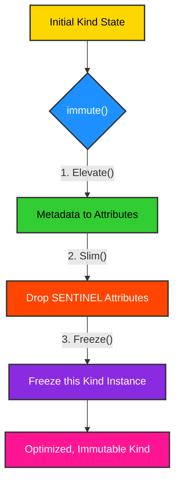
## `kind.ref`: Alias for `kind.origin` to Track Source Provenance

The `ref` property serves as a convenient, settable alias for `kind.origin` (default `None`; when a name is requested again with an origin, the first non-`None` origin given wins), providing a standardized way to track the provenance or original source of a `Kind` instance. This is particularly valuable in data lineage, auditing, or debugging scenarios where understanding the origin of a symbolic entity is crucial. By explicitly linking a `Kind` to its source, the framework enhances traceability and data governance.

### Purpose and Usage
To store and retrieve a reference to the original source or data from which the `Kind` was created. This helps in tracking data lineage.

### Code Example
```python
from kind import Kind

# Create kinds with origin
data_row = {'id': 123, 'value': 'abc'}
s1 = Kind('data_entry_123', origin=data_row)

file_path = '/path/to/source_file.txt'
s2 = Kind('config_setting_A', origin=file_path)

print(f"Kind s1 name: {s1.name}, origin (ref): {s1.ref}")
print(f"Kind s2 name: {s2.name}, origin (ref): {s2.ref}")

# You can also set the ref property
s3 = Kind('new_kind')
s3.ref = {'source': 'user_input', 'timestamp': '2025-07-04'}
print(f"Kind s3 name: {s3.name}, origin (ref): {s3.ref}")
```
<details>
<summary>Outcome</summary>

```text
Kind s1 name: data_entry_123, origin (ref): {'id': 123, 'value': 'abc'}
Kind s2 name: config_setting_A, origin (ref): /path/to/source_file.txt
Kind s3 name: new_kind, origin (ref): {'source': 'user_input', 'timestamp': '2025-07-04'}
```
</details>

### Diagram
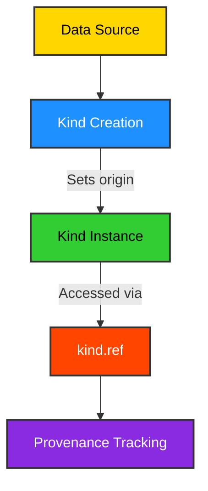
## `Scheduler.add_job(job)`: Schedules a New Job for Execution

The `Scheduler.add_job()` method is the primary interface for integrating tasks into the `Kind` framework's scheduling system. It allows for the registration of `ScheduledJob` instances, which encapsulate a callable function, its arguments, and the specified execution schedule. This method is crucial for enabling automated, time-based execution of arbitrary functions, supporting both one-off and recurring tasks. `ScheduledJob(func, args=(), kwargs=None, schedule=..., id=None)`; `Scheduler(schedule_file=None, allowed_modules=(), now=datetime.datetime.now)` resolves functions in a schedule file only from `allowed_modules`.

### Purpose and Usage
To add a `ScheduledJob` to the scheduler's queue for future execution. This is how you automate tasks within the `Kind` framework.

### Code Example
```python
import datetime

import anyio

from kind.core.schedule import ScheduledJob, Scheduler

clock = {"now": datetime.datetime(2026, 10, 2, 9, 0, 0)}  # injectable clock: deterministic steps
now = lambda: clock["now"]

def my_scheduled_task(message):
    print(f"[{now()}] Scheduled task executed: {message}")

# Initialize the scheduler
scheduler = Scheduler(now=now)

# Schedule a job to run in 5 seconds
job1 = ScheduledJob(my_scheduled_task, args=("Hello from future!",), schedule=now() + datetime.timedelta(seconds=5))
scheduler.add_job(job1)

# Schedule a recurring job using cron syntax (every minute)
job2 = ScheduledJob(my_scheduled_task, args=("Hello from recurring job!",), schedule="* * * * *", now=now())
scheduler.add_job(job2)

async def main():
    # run_due_jobs() is one step of the loop; start(task_group) runs that loop as a task
    for seconds in (10, 60, 120):
        clock["now"] = datetime.datetime(2026, 10, 2, 9, 0, 0) + datetime.timedelta(seconds=seconds)
        await scheduler.run_due_jobs()

anyio.run(main)
print(f"Jobs left: {len(scheduler.job_map)}")
```
<details>
<summary>Outcome</summary>

```text
[2026-10-02 09:00:10] Scheduled task executed: Hello from future!
[2026-10-02 09:01:00] Scheduled task executed: Hello from recurring job!
[2026-10-02 09:02:00] Scheduled task executed: Hello from recurring job!
Jobs left: 1
```
</details>

### Diagram
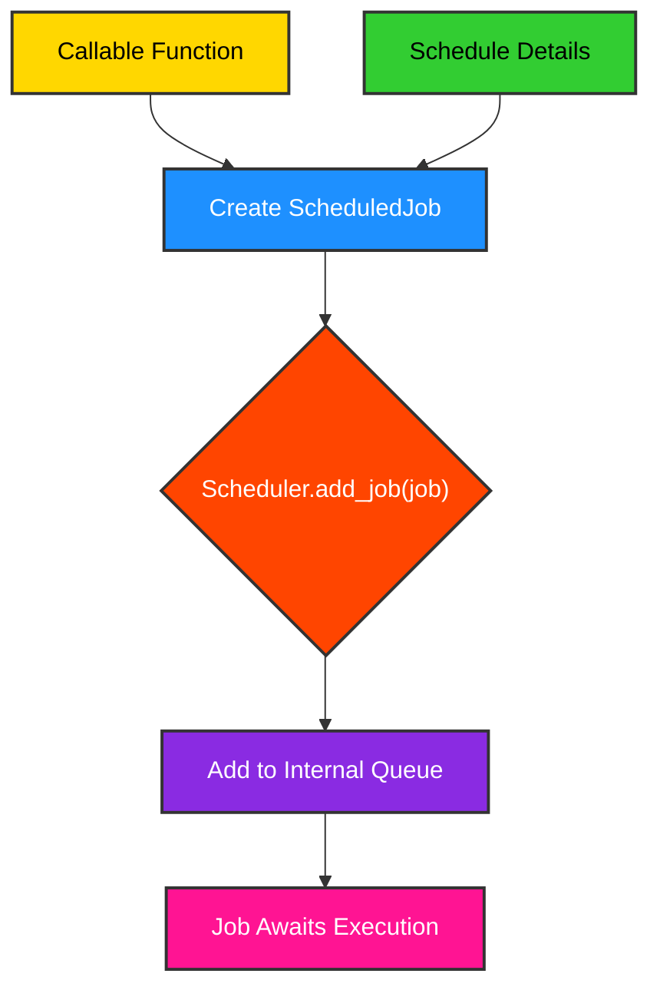
For a comprehensive overview of the Kind API, refer to the [API Overview Diagram](api_overview.mmd).

---
