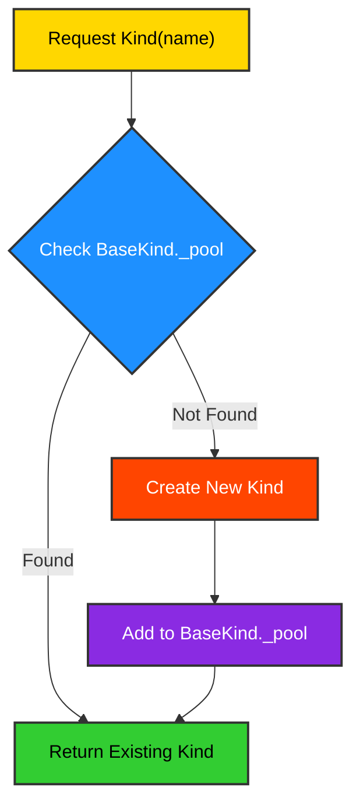
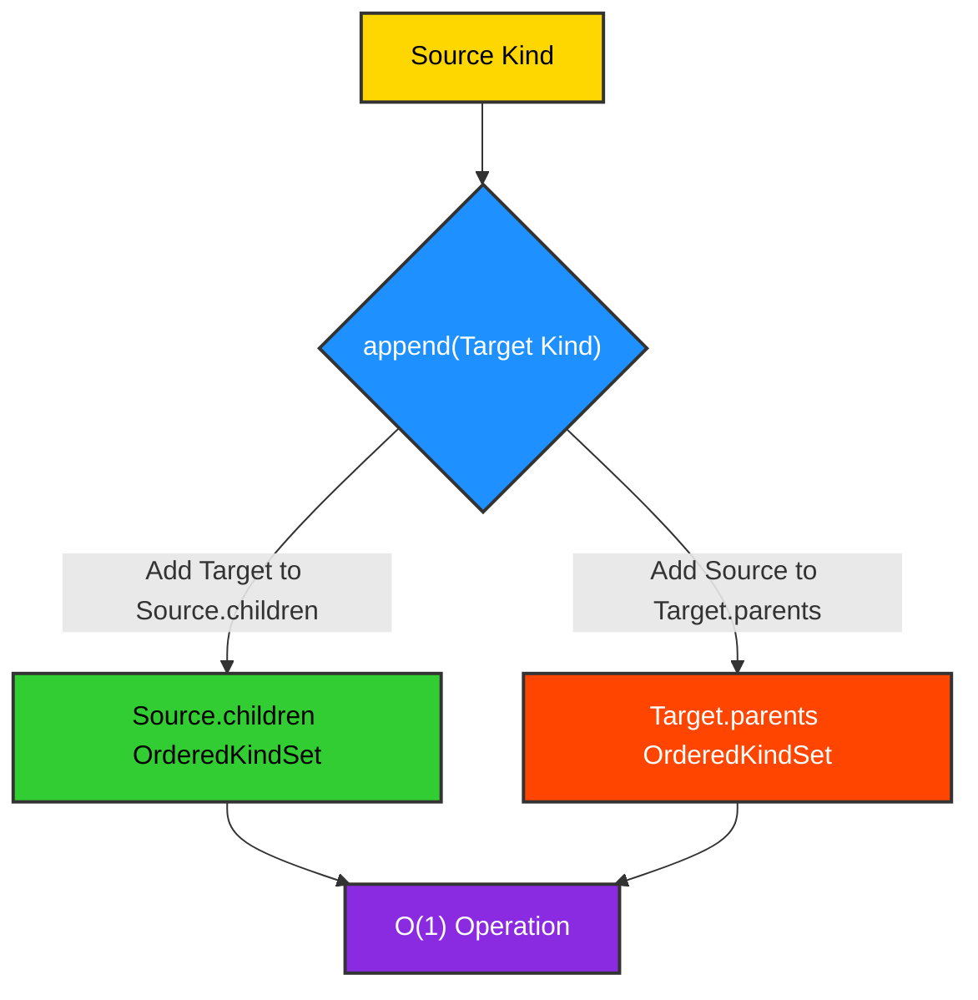
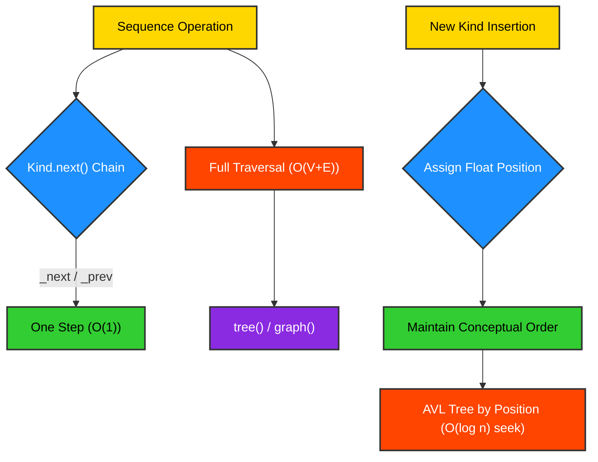
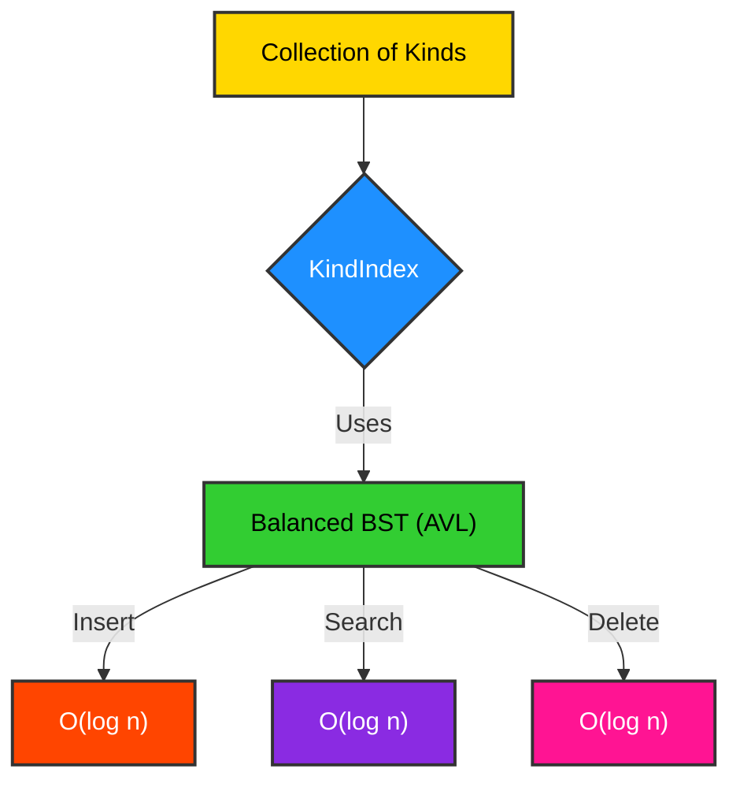

# Performance: Optimizing Symbolic Data Operations

The `Kind` framework is engineered for high performance, particularly in scenarios involving large-scale graph-based data structures. Its design incorporates several algorithmic and architectural optimizations to ensure efficient instantiation, relationship management, and traversal. This section delves into the underlying mechanisms that contribute to its favorable time complexities.

## O(1) Kind Instantiation (Intern Pool)

Kind instantiation is an average constant-time operation (one dictionary lookup under a lock), achieved through the implementation of an interning pool (a variation of the Flyweight design pattern). When a `Kind` is requested via `Kind(name)`, the framework first checks if a `Kind` with that `name` already exists in the pool, one for all classes. If it does, the existing instance is returned; otherwise, a new instance is created and added to the pool. This ensures that each unique symbolic name maps to a single, canonical `Kind` object, leading to significant memory savings and guaranteeing object identity: the pool is strong, so a name stays the same Kind, with its state, until `delete()` or `Kind.forget(name)` removes it.

### Mechanism
- **`BaseKind._pool`**: A plain `dict` that stores `Kind` instances, keyed by their `name`; `Kind.max_kinds` can cap its size (`KindLimitError`).
- **`BaseKind.__new__` method**: Overridden to implement the interning logic, ensuring that `Kind('A') is Kind('A')` evaluates to `True`.

### Code Example
```python
from kind import Kind

# Repeated instantiation of the same kind name
s1 = Kind('my_data_point')
s2 = Kind('my_data_point')
s3 = Kind('another_data_point')

print(f"s1 is s2: {s1 is s2}") # Expected: True (O(1) lookup)
print(f"s1 is s3: {s1 is s3}") # Expected: False

# Repeated construction is a pool lookup
import time

start_time = time.perf_counter_ns()
for _ in range(100000):
    Kind('test_kind')
end_time = time.perf_counter_ns()
print(f"Time for 100,000 Kind instantiations: {(end_time - start_time) / 1_000_000:.2f} ms")
```
<details>
<summary>Outcome</summary>

```text
s1 is s2: True
s1 is s3: False
Time for 100,000 Kind instantiations: 296.10 ms
```

Timings are one measured run; they vary by machine.
</details>

### Diagram

## O(1) Relationship Linking

Establishing relationships between `Kind` instances (e.g., via `append()`) is also an amortized constant-time operation. `children` and `parents` are `OrderedKindSet`s: a list for order plus a set for O(1) membership, so appending is an amortized O(1) list append and a repeated `append()` is an O(1) no-op. Placing a child at a position (`insert(child, at)`) and removing one are O(n) in the number of children.

### Mechanism
- **`Kind.children` and `Kind.parents`**: `OrderedKindSet`s (ordered, no duplicates, O(1) membership) that store direct references to related `Kind` objects.
- **`append()` method**: Directly adds a `Kind` to the `children` list of the current kind and adds the current kind to the `parents` list of the child kind.

### Code Example
```python
from kind import Kind

root = Kind('Root')
child_a = Kind('ChildA')
child_b = Kind('ChildB')

import time

start_time = time.perf_counter_ns()
root.append(child_a) # O(1)
root.append(child_b) # O(1)
end_time = time.perf_counter_ns()

print(f"Root children: {[c.name for c in root.children]}")
print(f"ChildA parents: {[p.name for p in child_a.parents]}")
print(f"Time for 2 relationship links: {(end_time - start_time) / 1_000_000:.2f} ms")
```
<details>
<summary>Outcome</summary>

```text
Root children: ['ChildA', 'ChildB']
ChildA parents: ['Root']
Time for 2 relationship links: 0.01 ms
```
</details>

### Diagram

## O(1) Sequence Steps and Float-based Positions

While full graph traversals (e.g., `tree()`, `graph()`) are inherently dependent on the number of nodes and edges (O(V+E)), stepping along the `Kind.next()` chain is O(1), and creation order is kept by float positions in an AVL tree. `Kind.len()` is `len(pool)`, O(1).

### Mechanism
- **Linked Sequence (`_prev`, `_next`)**: `Kind.next()` creates `kind_0`, `kind_1`, ... and links each to the previous one, so a step along the chain is O(1).
- **Float-based Positions (`_write_cursor`, `_position`)**: Every new Kind gets the next float position from `_write_cursor` and is added to an AVL tree of every pooled Kind (`BaseKind._numbered`) without re-indexing existing elements. `Kind.first()`/`last()`/`seek(pos)` read it in O(log n), and `Kind.each(start)` iterates the pooled Kinds in creation order.

### Code Example (Conceptual for Float-based Cursor)
```python
from kind import Kind

# Kind.next() uses float-based cursor for efficient chaining
kind0 = Kind.next()
kind1 = Kind.next()
kind2 = Kind.next()

print(f"kind0 position: {kind0._position}")
print(f"kind1 position: {kind1._position}")
print(f"kind2 position: {kind2._position}")

# Accessing next/prev in a chained sequence is O(1)
print(f"kind0._next is kind1: {kind0._next is kind1}")
print(f"kind2._prev is kind1: {kind2._prev is kind1}")
```
<details>
<summary>Outcome</summary>

```text
kind0 position: 0.0
kind1 position: 1.0
kind2 position: 2.0
kind0._next is kind1: True
kind2._prev is kind1: True
```
</details>

### Diagram

## O(log n) Insert/Search with the AVL-backed KindIndex

While core relationship linking is O(1), the `Kind` framework is designed to integrate with more advanced data structures for scenarios requiring ordered insertion and efficient searching within larger collections of kinds. Specifically, `kind.builtin.index` (backed by `AVLTree`) keeps a Kind's indexed kinds sorted by weight, so ordered insertion and searching by weight achieve O(log n) time complexity.

### Mechanism
- **`KindIndex`**: A per-Kind index (`kind.builtin.index`, reached as `kind.index`) that maintains kinds in weight order.
- **Balanced Binary Search Tree (AVL Tree)**: Implemented in `kind.builtin.avl_tree`, it provides logarithmic time complexity for insertion, deletion, and search by weight by maintaining a balanced tree structure.

### Code Example (Conceptual with KindIndex)

```python
from kind import Kind, k
from kind.builtin import apply_builtins

apply_builtins()

# Create a Kind and its associated index
root_kind = k.Root

root_kind.index.insert(k.Zebra, 0.3)
root_kind.index.insert(k.Apple, 0.1)
root_kind.index.insert(k.Banana, 0.2)

print(f"Kinds in index (sorted): {[s.name for s in root_kind.index.traverse()]}")

# KindIndex has no search by name; this scan over the sorted list is O(n).
# Search by weight is O(log n) on the underlying tree: root_kind.index.tree.search(0.1)
found_kind = next((s for s in root_kind.index.traverse() if s.name == 'Apple'), None)
print(f"Found Apple: {found_kind.name if found_kind else 'Not Found'}")
```
<details>
<summary>Outcome</summary>

```text
Kinds in index (sorted): ['Apple', 'Banana', 'Zebra']
Found Apple: Apple
```
</details>

### Diagram

## Conclusion

The `Kind` framework's performance characteristics are a direct result of its thoughtful design, leveraging efficient data structures and algorithms. By employing interning for constant-time instantiation, utilizing ordered sets for amortized O(1) relationship linking, and providing hooks for logarithmic-time ordered operations through specialized indices, `Kind` delivers a high-performance foundation for building and manipulating complex symbolic graphs. These optimizations are crucial for ensuring scalability and responsiveness in demanding applications.

For a comprehensive overview of the Kind's performance aspects, refer to the [Performance Overview Diagram](performance_overview.mmd).
