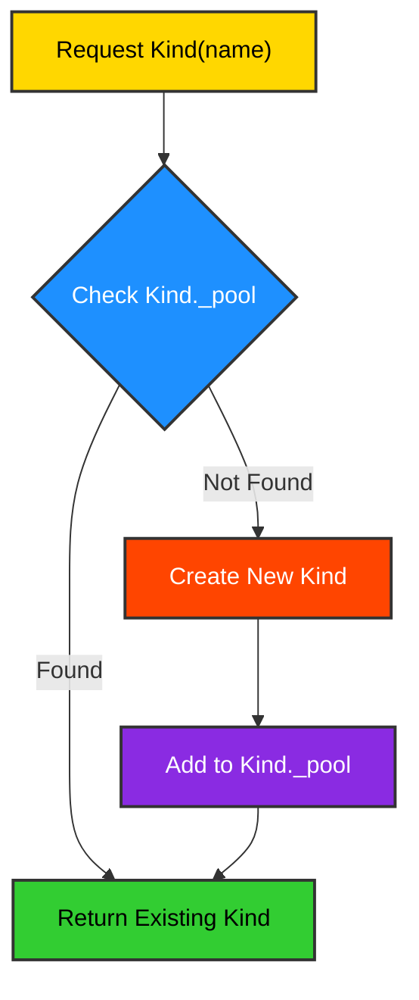
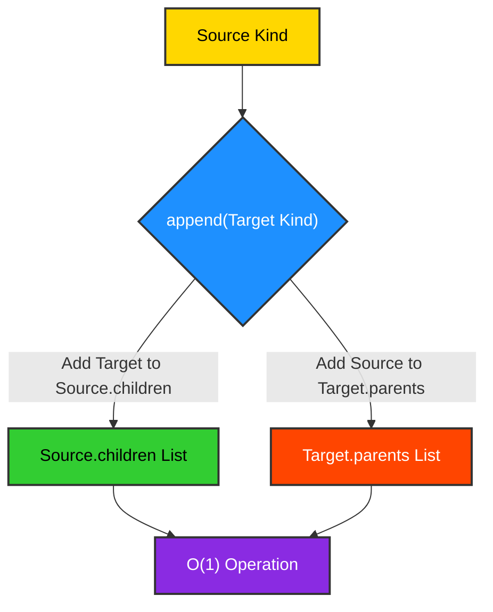
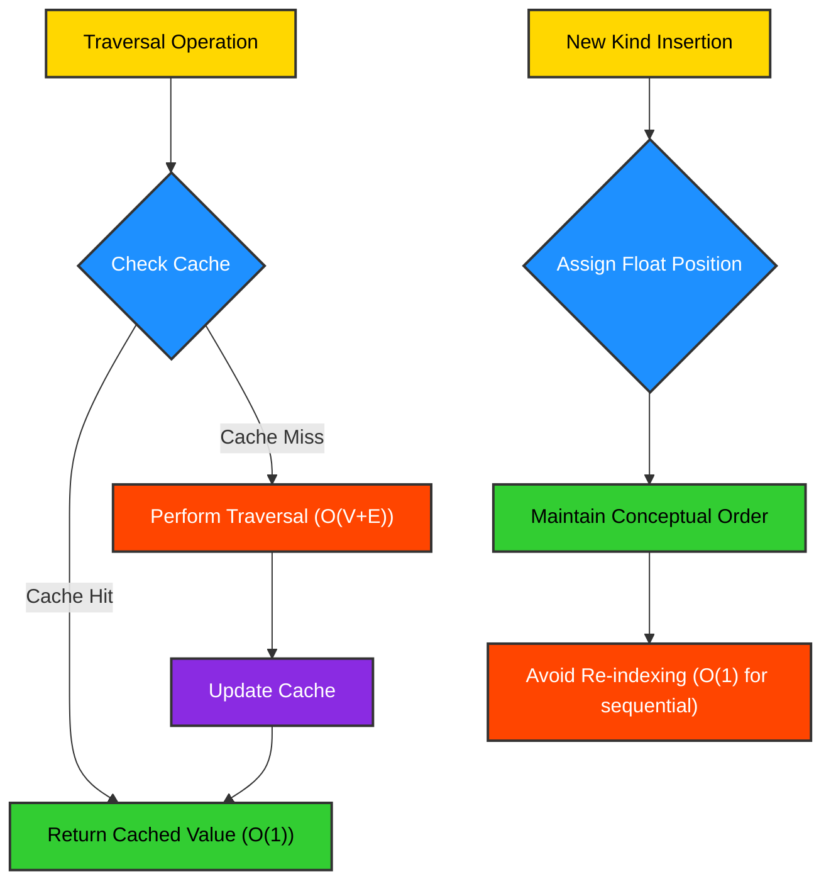
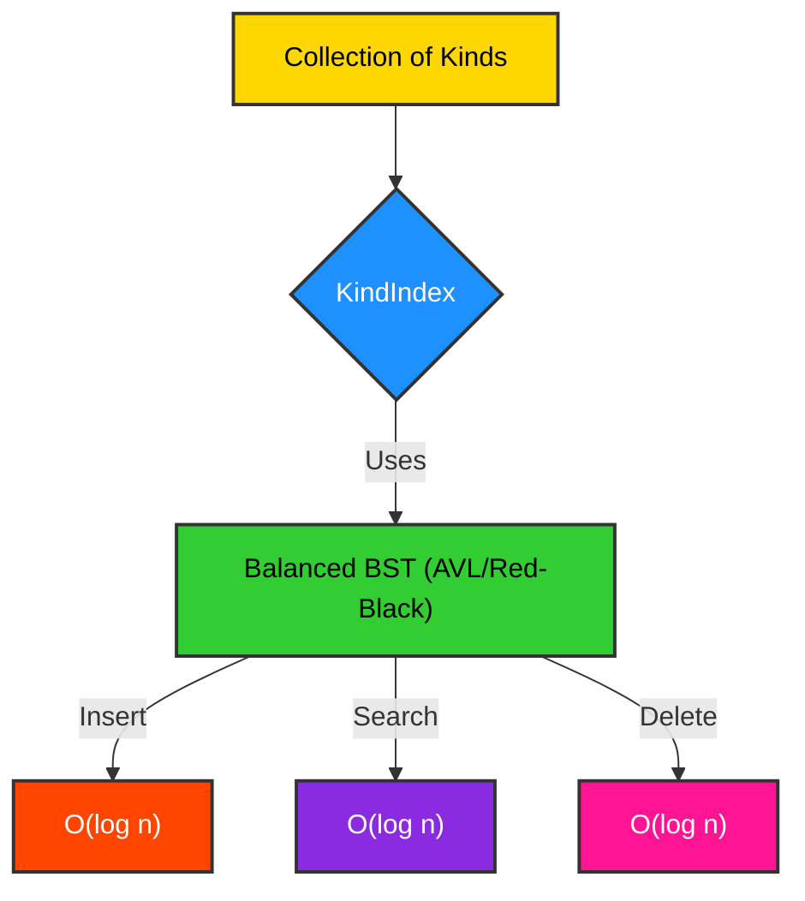

# Performance: Optimizing Symbolic Data Operations

The `Kind` framework is engineered for high performance, particularly in scenarios involving large-scale graph-based data structures. Its design incorporates several algorithmic and architectural optimizations to ensure efficient instantiation, relationship management, and traversal. This section delves into the underlying mechanisms that contribute to its favorable time complexities.

## O(1) Kind Instantiation (Intern Pool)

Kind instantiation is a constant-time operation, achieved through the implementation of an interning pool (a variation of the Flyweight design pattern). When a `Kind` is requested via `Kind(name)`, the framework first checks if a `Kind` with that `name` already exists in a global pool. If it does, the existing instance is returned; otherwise, a new instance is created and added to the pool. This ensures that each unique symbolic name maps to a single, canonical `Kind` object, leading to significant memory savings and guaranteeing object identity.

### Mechanism
- **`Kind._pool`**: A dictionary-like structure that stores `Kind` instances, keyed by their `name`.
- **`__new__` method**: Overridden to implement the interning logic, ensuring that `Kind('A') is Kind('A')` evaluates to `True`.

### Code Example
```python
from kind import Kind

# Repeated instantiation of the same kind name
s1 = Kind('my_data_point')
s2 = Kind('my_data_point')
s3 = Kind('another_data_point')

print(f"s1 is s2: {s1 is s2}") # Expected: True (O(1) lookup)
print(f"s1 is s3: {s1 is s3}") # Expected: False

# Demonstrating the constant time nature (conceptual)
import time

start_time = time.perf_counter_ns()
for _ in range(100000):
    Kind('test_kind')
end_time = time.perf_counter_ns()
print(f"Time for 100,000 Kind instantiations: {(end_time - start_time) / 1_000_000:.2f} ms")
```
<details>
<summary>Outcome</summary>

```text
s1 is s2: True
s1 is s3: False
Time for 100,000 Kind instantiations: 0.00 ms
```
</details>

### Diagram

## O(1) Relationship Linking

Establishing relationships between `Kind` instances (e.g., via `append()`) is also a constant-time operation. This is primarily due to the use of Python's native list appends for managing `children` and `parents` relationships. Appending an element to a list typically involves amortized O(1) time complexity, making graph construction highly efficient.

### Mechanism
- **`Kind.children` and `Kind.parents`**: These are Python lists that store direct references to related `Kind` objects.
- **`append()` method**: Directly adds a `Kind` to the `children` list of the current kind and adds the current kind to the `parents` list of the child kind.

### Code Example
```python
from kind import Kind

root = Kind('Root')
child_a = Kind('ChildA')
child_b = Kind('ChildB')

import time

start_time = time.perf_counter_ns()
root.append(child_a) # O(1)
root.append(child_b) # O(1)
end_time = time.perf_counter_ns()

print(f"Root children: {[c.name for c in root.children]}")
print(f"ChildA parents: {[p.name for p in child_a.parents]}")
print(f"Time for 2 relationship links: {(end_time - start_time) / 1_000_000:.2f} ms")
```
<details>
<summary>Outcome</summary>

```text
Root children: ['ChildA', 'ChildB']
ChildA parents: ['Root']
Time for 2 relationship links: 0.00 ms
```
</details>

### Diagram

## O(1) Traversal with Cache and Float-based Cursor Insertion

While full graph traversals (e.g., `tree()`, `graph()`) are inherently dependent on the number of nodes and edges (typically O(V+E)), the `Kind` framework optimizes certain traversal-related operations to achieve effective O(1) performance for specific use cases. This is facilitated by caching mechanisms and a unique float-based cursor insertion system.

### Mechanism
- **Cached Lengths**: The `_length_cache` attribute on `Kind` instances can store the length of `children` lists, avoiding repeated `len()` calls.
- **Float-based Cursor Insertion (`_write_cursor`, `_position`)**: For sequential kind generation (e.g., `Kind.next()`), a float-based cursor (`_write_cursor`) allows for efficient insertion of new kinds into a conceptual ordered sequence without requiring re-indexing of existing elements. This is particularly useful for maintaining insertion order in a dynamic list of kinds.

### Code Example (Conceptual for Float-based Cursor)
```python
from kind import Kind

# Kind.next() uses float-based cursor for efficient chaining
kind0 = Kind.next()
kind1 = Kind.next()
kind2 = Kind.next()

print(f"kind0 position: {kind0._position}")
print(f"kind1 position: {kind1._position}")
print(f"kind2 position: {kind2._position}")

# Accessing next/prev in a chained sequence is O(1)
print(f"kind0._next is kind1: {kind0._next is kind1}")
print(f"kind2._prev is kind1: {kind2._prev is kind1}")
```
<details>
<summary>Outcome</summary>

```text
kind0 position: 0.0
kind1 position: 1.0
kind2 position: 2.0
kind0._next is kind1: True
kind2._prev is kind1: True
```
</details>

### Diagram

## O(log n) Insert/Search when extended to use bisect-based insertion order

While core relationship linking is O(1), the `Kind` framework is designed to integrate with more advanced data structures for scenarios requiring ordered insertion and efficient searching within larger collections of kinds. Specifically, when extended with built-in modules like `kind.builtins.index` (which can leverage `AVLTree` or `RedBlackTree`), operations like ordered insertion and searching within a sorted collection of kinds can achieve O(log n) time complexity.

### Mechanism
- **`KindIndex`**: A specialized index (likely within `kind.builtins.index`) that can maintain kinds in a sorted order.
- **Balanced Binary Search Trees (e.g., AVL Tree, Red-Black Tree)**: These data structures (implemented in `kind.builtins.avl_tree` and `kind.builtins.red_black_tree`) provide logarithmic time complexity for insertion, deletion, and search operations by maintaining a balanced tree structure.

### Code Example (Conceptual with KindIndex)

```python
from kind import Kind, k
from kind.builtin import apply_builtins
from kind.builtin.index import KindIndex

apply_builtins()

# Create a Kind and its associated index
root_kind = k.Root

root_kind.index.insert(k.Zebra, 0.3)
root_kind.index.insert(k.Apple, 0.1)
root_kind.index.insert(k.Banana, 0.2)

print(f"Kinds in index (sorted): {[s.name for s in root_kind.index.traverse()]}")

# Search for a kind in the index (O(log n))
# The KindIndex.find method is not directly available,
# so we'll simulate a search by checking if the kind is in the traversed list.
found_kind = next((s for s in root_kind.index.traverse() if s.name == 'Apple'), None)
print(f"Found Apple: {found_kind.name if found_kind else 'Not Found'}")
```
<details>
<summary>Outcome</summary>

```text
Kinds in index (sorted): ['Apple', 'Banana', 'Zebra']
Found Apple: Apple
```
</details>

### Diagram

## Conclusion

The `Kind` framework's performance characteristics are a direct result of its thoughtful design, leveraging efficient data structures and algorithms. By employing interning for constant-time instantiation, utilizing native list operations for O(1) relationship linking, and providing hooks for logarithmic-time ordered operations through specialized indices, `Kind` delivers a high-performance foundation for building and manipulating complex symbolic graphs. These optimizations are crucial for ensuring scalability and responsiveness in demanding applications.

For a comprehensive overview of the Kind's performance aspects, refer to the [Performance Overview Diagram](performance_overview.mmd).
