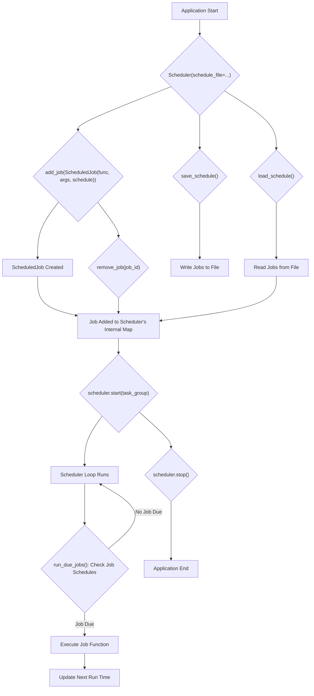
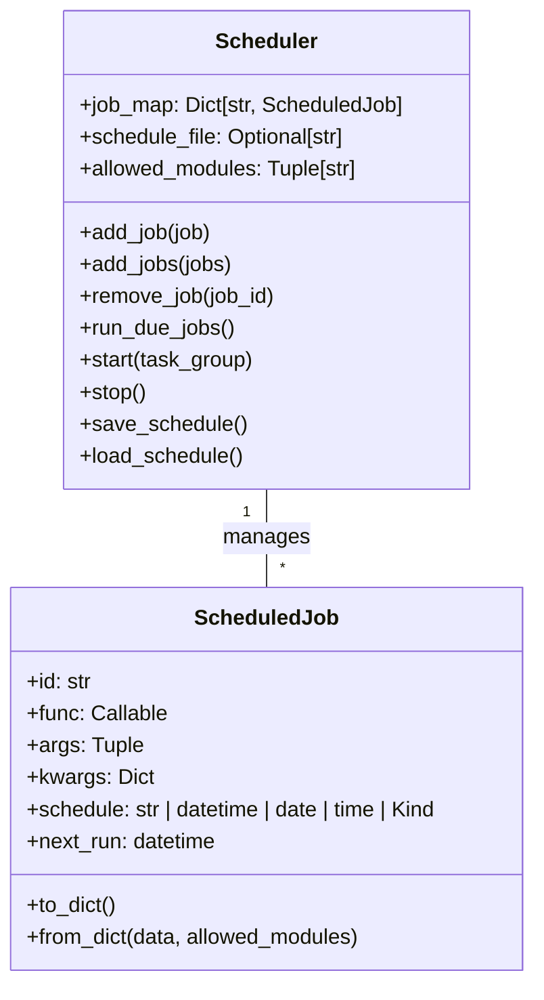

# `kind-scheduler` cookbook

> ⚠ _This package is under development. Where this page and the code differ, the code is right; test your schedules, especially the async batch functions._
 
# Recipe: Scheduling Jobs with `kind_scheduler`

A `Scheduler` runs each `ScheduledJob` when its next run is due: once for a datetime, date, time or ISO 8601 string, repeatedly for a cron expression. The package is `kind_scheduler` (distribution `kind-scheduler`, separate from `kind`).

## 1. Understanding `kind_scheduler`

The `kind_scheduler` package is built around the `Scheduler` class, which manages a collection of `ScheduledJob` instances. Each `ScheduledJob` encapsulates a function to be executed, its arguments, and a schedule (e.g., cron string or ISO 8601 timestamp).

### Key Components:

-   **`Scheduler`**: The central component responsible for adding, removing, listing, and running scheduled jobs.
-   **`ScheduledJob`**: Represents a single job to be executed, including the target function, its arguments, and the schedule.

## 2. Basic Usage: Adding and Running a Job

Let's start with a simple example: scheduling a function to run every minute.

<!-- doc-example: not-run — the scheduler runs until interrupted (Ctrl+C) -->
```python
import kind_scheduler
import datetime
import anyio

# 1. Define the function to be scheduled
def my_scheduled_task(message: str):
    print(f"[{datetime.datetime.now()}] Scheduled task executed: {message}")

# 2. Create a Scheduler instance
#    You can optionally provide a schedule_file to persist jobs
scheduler = kind_scheduler.Scheduler()

# 3. Add a job
#    The schedule can be a cron string (e.g., "* * * * *" for every minute)
#    or an ISO 8601 timestamp for a one-time execution.
job = kind_scheduler.ScheduledJob(
    func=my_scheduled_task,
    args=("Hello from scheduler!",),
    schedule="* * * * *" # Run every minute
)
scheduler.add_job(job)
print(f"Job '{job.id}' added to the scheduler.")

# 4. Start the scheduler in a task group (this will block until stopped)
async def main():
    async with anyio.create_task_group() as task_group:
        await scheduler.start(task_group)

print("Starting scheduler. Press Ctrl+C to stop.")
try:
    anyio.run(main)
except KeyboardInterrupt:
    print("Scheduler stopped.")
```

### Explanation:

-   We define `my_scheduled_task` as the function to be executed.
-   A `Scheduler` instance is created.
-   A `ScheduledJob` wraps `my_scheduled_task` with a cron schedule `"* * * * *"`; `scheduler.add_job()` registers it.
-   `scheduler.start(task_group)` begins the scheduling loop as a task. The `try...except KeyboardInterrupt` block allows for graceful shutdown; `await scheduler.stop()` ends the loop from inside the application.

## 3. Managing Jobs: Listing, Removing and Stepping

You can inspect and manage the jobs currently in the scheduler. With an injected clock (`now=`) and `run_due_jobs()`, which runs one deterministic step of the loop, no waiting is needed.

```python
import kind_scheduler
import datetime
import anyio

def another_task():
    print("Another task executed.")

def one_time_task():
    print("One-time job!")

clock = [datetime.datetime(2026, 1, 1, 12, 0)]
scheduler = kind_scheduler.Scheduler(now=lambda: clock[0])

job1 = kind_scheduler.ScheduledJob(another_task, schedule="*/5 * * * *", now=clock[0]) # Every 5 minutes
job2 = kind_scheduler.ScheduledJob(one_time_task, schedule=clock[0] + datetime.timedelta(seconds=10), now=clock[0])
scheduler.add_jobs([job1, job2])

print("--- Current Jobs ---")
for job_id, job in scheduler.job_map.items():
    print(f"Next Run: {job.next_run}, Schedule: {job.schedule}, Function: {job.func.__name__}")

# Remove a job
scheduler.remove_job(job1.id)
print(f"\nJob '{job1.func.__name__}' removed.")

print("\n--- Jobs After Removal ---")
for job_id, job in scheduler.job_map.items():
    print(f"Next Run: {job.next_run}, Schedule: {job.schedule}, Function: {job.func.__name__}")

# Advance the clock and run one step: the one-time job executes
clock[0] += datetime.timedelta(seconds=10)
ran = anyio.run(scheduler.run_due_jobs)
print(f"\nJobs run: {ran}, jobs left: {len(scheduler.job_map)}")
```
<details>
<summary>Outcome</summary>

```text
--- Current Jobs ---
Next Run: 2026-01-01 12:05:00, Schedule: */5 * * * *, Function: another_task
Next Run: 2026-01-01 12:00:10, Schedule: 2026-01-01 12:00:10, Function: one_time_task

Job 'another_task' removed.

--- Jobs After Removal ---
Next Run: 2026-01-01 12:00:10, Schedule: 2026-01-01 12:00:10, Function: one_time_task
One-time job!

Jobs run: 1, jobs left: 0
```
</details>

## 4. Persisting Schedules

For long-running applications, you'll want to persist your scheduled jobs so they are not lost when the application restarts. The `Scheduler` saves the schedule to its file whenever jobs change, and loads it on creation. A schedule file names functions by dotted path, and loading it imports code, so a `Scheduler` only resolves functions from the modules listed in `allowed_modules`; anything else raises `CallableNotAllowedError`.

```python
import kind_scheduler
import datetime
import os

SCHEDULE_FILE = "my_schedule.json"

def persistent_task():
    print(f"[{datetime.datetime.now()}] Persistent task executed.")

# Clean up previous schedule file if it exists
if os.path.exists(SCHEDULE_FILE):
    os.remove(SCHEDULE_FILE)

# First run: Add a job (add_job saves the schedule)
print("--- First Run: Adding and Saving Job ---")
scheduler1 = kind_scheduler.Scheduler(schedule_file=SCHEDULE_FILE)
scheduler1.add_job(kind_scheduler.ScheduledJob(persistent_task, schedule="* * * * *"))
print(f"Job added and schedule saved to '{SCHEDULE_FILE}'.")

# Second run: Loading refuses functions from modules that were not allowed
print("\n--- Second Run: Loading the Job ---")
try:
    kind_scheduler.Scheduler(schedule_file=SCHEDULE_FILE)
except kind_scheduler.CallableNotAllowedError:
    print("Refused: '__main__' is not in allowed_modules.")

scheduler2 = kind_scheduler.Scheduler(schedule_file=SCHEDULE_FILE, allowed_modules=["__main__"])
print("Loaded jobs:")
for job_id, job in scheduler2.job_map.items():
    print(f"Schedule: {job.schedule}, Function: {job.func.__name__}")

os.remove(SCHEDULE_FILE) # Clean up
```
<details>
<summary>Outcome</summary>

```text
--- First Run: Adding and Saving Job ---
Job added and schedule saved to 'my_schedule.json'.

--- Second Run: Loading the Job ---
Refused: '__main__' is not in allowed_modules.
Loaded jobs:
Schedule: * * * * *, Function: persistent_task
```
</details>

The same schedule file can be managed from the command line, where every module whose functions jobs may run is given with `-m` (`--allow-module`, repeatable):

```bash
kind-scheduler -f my_schedule.json -m my_module add my_module.my_function "*/5 * * * *"
kind-scheduler -f my_schedule.json -m my_module list
kind-scheduler -f my_schedule.json -m my_module remove JOB_ID
kind-scheduler -f my_schedule.json -m my_module run
```

## 5. Diagrams

### Scheduler Workflow




### `ScheduledJob` Structure



